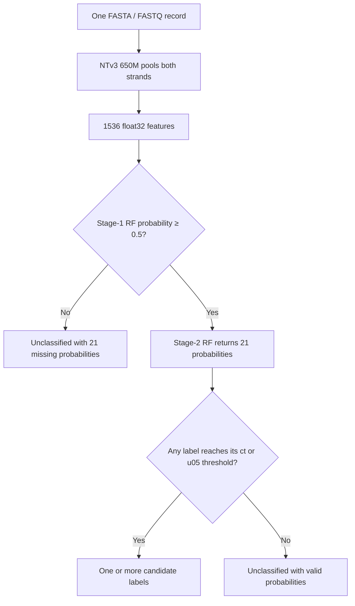

# IncFinder 0.5.0rc2

**English** · [简体中文](README.zh-CN.md)

IncFinder assigns candidate plasmid incompatibility (Inc) labels to individual sequenced records. Give it a FASTA or FASTQ file. Open **inc_results.csv** for one row per record, then inspect the probabilities and run provenance as needed.

**Research preview** · [Signed rc2 release](https://github.com/chrisjack007/IncFinder_showcase/releases/tag/v0.5.0rc2) · [Model card](docs/MODEL_CARD.en.md) · [Package table guide](docs/PACKAGE-TABLES.en.md) · [Input and output examples](#sample-results) · [Architecture](#rc2-architecture)

**Where the 21 Inc labels come from**

The study used skani to dereplicate complete plasmids and MOB-suite to type their representatives. It grouped 39 original subtypes into 21 positive labels. After splitting the parents by date, it sampled fragments with MetaSim. Every training or holdout record inherits its parent’s reference labels. Look up a fragment ID to find its versioned GenBank record, or a label to see its members, rationale and counts. [Provenance guide](provenance/README.md) · [39 subtype decisions](provenance/subtype-policy.tsv) · [How to read the eight mapping fields](provenance/FIELDS.md#subtype-policy) · [Row-level data and replay results](https://github.com/chrisjack007/IncFinder_showcase/releases/tag/v0.5.0rc2-provenance.1)

<details>
<summary>Show the four stages and counts from GenBank to model records</summary>

Read down the rows in execution order. The first column names the stage and the second gives its inputs, selection rules and outputs. ANI is average nucleotide identity over aligned regions. Each AF is the fraction of one sequence covered by the alignment. Counts change from plasmids to clusters to model records, so adding stages would count the same material more than once.

| Stage | Data and decisions |
|---|---|
| Source records and dereplication | GenBank yielded 97,904 plasmid records. Six belonged to assemblies absent from the date catalog. All 97,898 dated records became graph nodes, of which 97,750 met the 500 bp search cutoff. ANI ≥80% with both alignment fractions ≥90% yielded 45,911 clusters. Representatives were chosen by earliest assembly release date, then greatest length, then historical path in lexical order. |
| Typing complete plasmids | MOB-suite typed all 45,911 representatives. Each distinct Inc subtype was counted once per parent. Of 10,664 Inc-positive parents, 5,046 retained multiple final labels. The other 35,247 parents supply the stage-one No_Inc class. |
| Grouping subtypes | Counts of distinct parents, a threshold of 100 and the branch decisions of 7 May 2026 determined the classes. IncHI1A and IncHI1B together covered 715 distinct IncHI1 parents. Seven low-count IncX subtypes together covered 116 IncX_other parents. |
| Splitting and sampling | By assembly release date, 36,527 parents through 2024 entered training and the later 9,384 entered the holdout. MetaSim supplied 800,000 and 200,000 fragments respectively. Adding 265 and 95 complete plasmids shorter than 1,000 bp brought the total to 1,000,360 model records. |

</details>

## Quick start

Choose your platform row, download **one script** from either Original rc2 (Conda) or Portable rc2 (bundled runtime), then follow **Open the menu** in that row. For Docker, start a Linux container engine and choose the script for your host.

| Platform (x86-64) | Original rc2 | Portable rc2 | Open the menu |
| --- | --- | --- | --- |
| Windows | [Windows script](https://github.com/chrisjack007/IncFinder_showcase/releases/download/v0.5.0rc2/IncFinder-Start.cmd) | [Windows script](https://github.com/chrisjack007/IncFinder_showcase/releases/download/v0.5.0rc2-portable.1/IncFinder-Start.cmd) | Double-click `IncFinder-Start.cmd` |
| WSL2 | [WSL2 script](https://github.com/chrisjack007/IncFinder_showcase/releases/download/v0.5.0rc2/incfinder-start.sh) | [WSL2 script](https://github.com/chrisjack007/IncFinder_showcase/releases/download/v0.5.0rc2-portable.1/incfinder-start.sh) | In WSL2, run `bash incfinder-start.sh` |
| Native Linux | [Linux script](https://github.com/chrisjack007/IncFinder_showcase/releases/download/v0.5.0rc2/incfinder-start.sh) | [Linux script](https://github.com/chrisjack007/IncFinder_showcase/releases/download/v0.5.0rc2-portable.1/incfinder-start.sh) | Run `bash incfinder-start.sh` |
| Docker | [Windows](https://github.com/chrisjack007/IncFinder_showcase/releases/download/v0.5.0rc2/IncFinder-Start.cmd) · [Linux](https://github.com/chrisjack007/IncFinder_showcase/releases/download/v0.5.0rc2/incfinder-start.sh) | [Windows](https://github.com/chrisjack007/IncFinder_showcase/releases/download/v0.5.0rc2-portable.1/IncFinder-Start.cmd) · [Linux](https://github.com/chrisjack007/IncFinder_showcase/releases/download/v0.5.0rc2-portable.1/incfinder-start.sh) | Open the host script and select **2 · Docker** |

**For your first run, choose a runtime, then choose 2 · Install + demo.** At the first prompt, press Enter for native execution or enter 2 for Docker. The script selects the correct archive, verifies its release signature and SHA-256, prepares the environment and official models, runs `version`, `doctor`, and `models verify`, and analyzes the two records in `sample.fasta`. It prints both calls and the full paths to the CSV and Excel workbook. The raw-read preview uses CPU, batch size 1, four threads and one RF job. The run records encoder equivalence as `NOT_ESTABLISHED`.

Each row is one action you can choose. **Menu** gives its number and name, **Short command** gives the equivalent argument after the launcher filename, and **Action** describes the outcome.

| Menu | Short command | Action |
| --- | --- | --- |
| 1 · Download | `download` | Verify and unpack the selected software. Use this to prepare the package in advance. |
| 2 · Install + demo | `install` | Complete setup and run the bundled FASTA using official `ct` thresholds. |
| 3 · Run | `run` | Enter a FASTA/FASTQ path, including gzip input. On Windows, press Enter to choose a file. Each run gets a new folder. |
| 4 · Config | `config` | Edit settings, choose a verified model directory, or review an existing run with different thresholds. |

From the directory containing your downloaded script, use one short command for your own file. For Docker, add `--docker` before `run`.

```powershell
.\IncFinder-Start.cmd run reads.fasta
```

```bash
bash incfinder-start.sh run reads.fasta
```

**Models and offline use.** Request access to NTv3 before first setup. The official models occupy about 27.36 GB. Allow 60 GB of free space for initial preparation. Enter your token in the official login prompt. A complete, verified model directory can be reused by both releases. In native Conda mode, install Conda first if the launcher prompts, then reopen it to resume. After preparation, inference and threshold review run offline. [NTv3 access](https://huggingface.co/InstaDeepAI/NTv3_650M_pre) · [Miniforge](https://github.com/conda-forge/miniforge)

**Thresholds and reports.** Menu 4 saves settings for this release and platform or applies them to the next run only. `ct` uses the 21 official class thresholds. `0.5` is the official `u05` mode. To use custom thresholds, enter a number in [0, 1], edit a named class, or export and re-import the 21-row UTF-8 TSV. Choose **Review** and give it a completed rc2 results directory to reapply thresholds without rerunning the models. A new `review-…` directory holds the summary CSV, 21-class decisions CSV, actual thresholds, a three-sheet Excel workbook and `review.json` with the source run ID and hashes. Stage 1 still requires a probability of at least 0.5. [Official threshold table](https://github.com/chrisjack007/IncFinder_showcase/blob/v0.5.0rc2/NT_V3_650M_TSRF_SW/config/thresholds.tsv)

The script verifies its host helper before starting. To prepare it offline, place the matching helper from the same release beside the script. The software archives retain their original signed manifests. [Original launcher checksums](https://github.com/chrisjack007/IncFinder_showcase/releases/download/v0.5.0rc2/LAUNCHER-SHA256SUMS) · [Portable launcher checksums](https://github.com/chrisjack007/IncFinder_showcase/releases/download/v0.5.0rc2-portable.1/LAUNCHER-SHA256SUMS) · [Original signature](https://github.com/chrisjack007/IncFinder_showcase/releases/download/v0.5.0rc2/LAUNCHER-SHA256SUMS.sig) · [Portable signature](https://github.com/chrisjack007/IncFinder_showcase/releases/download/v0.5.0rc2-portable.1/LAUNCHER-SHA256SUMS.sig) · [Launcher source](launcher/)

<details>
<summary>Short configuration commands and offline preparation</summary>

Find the configuration or review task in the left column. Append the arguments from the same row to the launcher filename, or choose the corresponding menu item.

| Task | Arguments |
| --- | --- |
| Show current settings | `config show` |
| Use the official 0.5 mode for the next run | `config --once threshold 0.5` |
| Export or import all 21 thresholds | `config export thresholds.tsv` or `config import thresholds.tsv` |
| Restore defaults | `config reset` |
| Review existing results with current thresholds | `review "results directory"` |

By default, results go under `IncFinder/results/<release tag>/<platform>/` in your home directory. For offline extraction, point `INCFINDER_START_ASSETS` to the directory holding your downloaded release archive. The original edition also needs the locked Conda environment or its cached dependencies. Docker uses the `incfinder-rc2-model-store` model volume by default. Set `INCFINDER_START_MODEL_VOLUME` to use another volume containing `models/`.

</details>

## Manual installation and use

Choose one platform row for its signed installation archive, copyable terminal commands and matching recording. Start in a writable working directory and keep using the same terminal. Each guide ends with the two records supplied in the archive.

| Platform | Installation archive | Copy commands | Watch · WebM |
| --- | --- | --- | --- |
| Windows x64 | [Windows ZIP](https://github.com/chrisjack007/IncFinder_showcase/releases/download/v0.5.0rc2/incfinder-0.5.0rc2-win-64.zip) | [PowerShell](#windows) | [Windows recording](https://chrisjack007.github.io/IncFinder_showcase/docs/media/rc2/windows.webm) |
| WSL2 x64 | [Linux TAR.GZ](https://github.com/chrisjack007/IncFinder_showcase/releases/download/v0.5.0rc2/incfinder-0.5.0rc2-linux-64.tar.gz) | [WSL Bash](#wsl2) | [WSL2 recording](https://chrisjack007.github.io/IncFinder_showcase/docs/media/rc2/wsl2.webm) |
| Native Linux x64 | [Linux TAR.GZ](https://github.com/chrisjack007/IncFinder_showcase/releases/download/v0.5.0rc2/incfinder-0.5.0rc2-linux-64.tar.gz) | [Bash](#linux) | [Native Linux recording](https://chrisjack007.github.io/IncFinder_showcase/docs/media/rc2/linux.webm) |
| Docker linux/amd64 | [Linux TAR.GZ](https://github.com/chrisjack007/IncFinder_showcase/releases/download/v0.5.0rc2/incfinder-0.5.0rc2-linux-64.tar.gz) | [Docker Desktop / PowerShell](#docker) | [Docker recording](https://chrisjack007.github.io/IncFinder_showcase/docs/media/rc2/docker.webm) |

The four videos replay commands and terminal output captured on their respective platforms, with English and Chinese captions. They use a verified model directory. Waiting intervals are shortened. [Download the recordings](docs/media/rc2/)

For the separate extract-and-run distribution, choose the **portable.1** release. Its Docker section includes the input mount required for row-level lineage. [Portable downloads and Docker lineage](https://github.com/chrisjack007/IncFinder_showcase/releases/tag/v0.5.0rc2-portable.1)

<a id="rc2-workflow"></a>

### From download to results


### Before installing

For a native install use a Conda-enabled terminal with curl, tar and OpenSSH `ssh-keygen` supporting `-Y verify`. Windows includes `curl.exe` and supports `Expand-Archive`. Docker Desktop uses the Linux container engine. Use a new `IncFinder_Test1` environment. If you already have a verified rc2 installation, activate it and start at model configuration. [Miniforge](https://github.com/conda-forge/miniforge)

Request access to the official NTv3 checkpoint before the first model install. The installer obtains both RFs from this GitHub release and the pinned encoder files from Hugging Face. Installed models occupy about **27.36 GB**. Reserve at least **60 GB of free space on the model filesystem** for downloads and staging, plus space for the environment, outputs or Docker image. Subsequent inference can run offline. Enter your Hugging Face token only at the interactive login prompt. [NTv3 650M](https://huggingface.co/InstaDeepAI/NTv3_650M_pre) · [Pinned implementation](https://huggingface.co/InstaDeepAI/ntv3_base_model/tree/27682ed2f537a4c4fcc356b6b8201e7dfceca602)

The commands pin the SHA-256 of the public signer file, verify the detached signature on `SHA256SUMS`, and then check the exact archive being extracted. Expect an ED25519 signature from `incfinder-release` with fingerprint `SHA256:MoIhr1BXeQBxbBFtycnWNica1CWnm/uguMkVGUnJGXY` and an `OK` for your archive. [Registered signer](https://github.com/chrisjack007/IncFinder_showcase/blob/046307df31d02dd5e66986f73f22bcad0b58eab7/licenses/incfinder-release-allowed-signers)

## Windows

<details>
<summary>Windows — manual installation and prediction commands</summary>

Use a Conda-enabled PowerShell terminal on Windows x64. [Watch this platform](https://chrisjack007.github.io/IncFinder_showcase/docs/media/rc2/windows.webm)

**1. Download, verify and extract**

<details>
<summary>Show copyable download commands</summary>

```powershell
$ErrorActionPreference = 'Stop'
$work = Join-Path $PWD ('incfinder-rc2-' + [guid]::NewGuid().ToString('N').Substring(0,8))
New-Item -ItemType Directory -Path $work | Out-Null
Set-Location -LiteralPath $work
$archive = 'incfinder-0.5.0rc2-win-64.zip'
$release = 'https://github.com/chrisjack007/IncFinder_showcase/releases/download/v0.5.0rc2'
foreach ($name in @($archive, 'SHA256SUMS', 'SHA256SUMS.sig', 'allowed_signers')) {
    curl.exe --fail --location --silent --show-error --connect-timeout 15 --max-time 120 --retry 2 --output $name "$release/$name"
    if ($LASTEXITCODE) { throw "Download failed for $name" }
}
$keyHash = '25ad764a353930a61b951e12bf431d9a01e7a36a9136acf3331df360e0a47f4b'
if ((Get-FileHash -Algorithm SHA256 -LiteralPath allowed_signers).Hash -ne $keyHash) { throw "Unexpected release signing key" }
cmd.exe /d /c "ssh-keygen -Y verify -f allowed_signers -I incfinder-release -n incfinder-release -s SHA256SUMS.sig < SHA256SUMS"
if ($LASTEXITCODE) { throw 'Release signature verification failed' }
$record = @(Get-Content -LiteralPath SHA256SUMS | Where-Object { ($_ -split '\s+', 2)[1] -ceq $archive })
if ($record.Count -ne 1 -or (Get-FileHash -Algorithm SHA256 -LiteralPath $archive).Hash -ne ($record[0] -split '\s+', 2)[0]) { throw "SHA-256 mismatch for $archive" }
Write-Output "$archive OK"
Expand-Archive -LiteralPath $archive -DestinationPath .
Set-Location -LiteralPath incfinder-0.5.0rc2
```

</details>

**2. Install IncFinder in Conda**

```powershell
conda create --override-channels -c conda-forge -n IncFinder_Test1 --file environments/win-64.lock
if ($LASTEXITCODE) { throw 'Environment creation failed' }
conda activate IncFinder_Test1
if (-not $env:CONDA_PREFIX -or (Split-Path -Leaf $env:CONDA_PREFIX) -ine 'IncFinder_Test1') { throw 'Activate IncFinder_Test1 first' }
conda install --offline --override-channels -c conda-forge ./dist/channel/noarch/incfinder-0.5.0rc2-py_0.conda
if ($LASTEXITCODE) { throw 'IncFinder installation failed' }
```

**3. Configure the model and result directories**

The default model directory is `models` under the extracted package. To reuse a verified cache, set `INCFINDER_MODEL_DIR` to that directory before this block. A new result directory is created for each session.

```powershell
$Models = if ($env:INCFINDER_MODEL_DIR) { $env:INCFINDER_MODEL_DIR } else { Join-Path $PWD 'models' }
$Runs = Join-Path $HOME ('incfinder-results/run-' + [guid]::NewGuid().ToString('N').Substring(0,8))
New-Item -ItemType Directory -Path $Runs -Force | Out-Null
```

For the first model installation, run the following after receiving official access. When using a verified cache, proceed to the checks.

```powershell
hf auth login
incfinder models install --model-dir "$Models" --download-rf --download-ntv3
```

**4. Check software and models**

`version` prints `incfinder 0.5.0rc2`. `doctor` checks dependencies, package resources and model file sizes. `models verify` reads the full model files and checks SHA-256. Both checks should print `PASS`. The result directory holds their complete JSON reports.

```powershell
incfinder version
incfinder doctor --model-dir "$Models" > "$Runs/doctor.json"
(Get-Content -Raw "$Runs/doctor.json" | ConvertFrom-Json).status
incfinder models verify --model-dir "$Models" > "$Runs/verify.json"
(Get-Content -Raw "$Runs/verify.json" | ConvertFrom-Json).status
```

**5. Run a FASTA and a FASTQ example**

The first command uses the default `ct` thresholds. The second uses `u05`. Each writes to a new directory. `--allow-encoder-drift` acknowledges that raw-sequence encoding can vary across supported platforms. The run records `NOT_ESTABLISHED` for scientific equivalence.

```powershell
incfinder predict examples/sample.fasta --model-dir "$Models" --device cpu --batch-size 1 --threads 4 --jobs 1 --allow-encoder-drift --output "$Runs/fasta-ct" > "$Runs/fasta-ct.json"
incfinder predict examples/sample.fastq --model-dir "$Models" --device cpu --batch-size 1 --threads 4 --jobs 1 --allow-encoder-drift --threshold-mode u05 --output "$Runs/fastq-u05" > "$Runs/fastq-u05.json"
```

<details>
<summary>Run both threshold modes on each file (optional)</summary>

```powershell
incfinder predict examples/sample.fasta --model-dir "$Models" --device cpu --batch-size 1 --threads 4 --jobs 1 --allow-encoder-drift --threshold-mode u05 --output "$Runs/fasta-u05" > "$Runs/fasta-u05.json"
incfinder predict examples/sample.fastq --model-dir "$Models" --device cpu --batch-size 1 --threads 4 --jobs 1 --allow-encoder-drift --output "$Runs/fastq-ct" > "$Runs/fastq-ct.json"
```

</details>

**6. Open the calls and trace row 0**

```powershell
Import-Csv "$Runs/fasta-ct/inc_results.csv" | Format-Table row_index,Header,Result,gate_pass,internal_status -AutoSize
incfinder lineage "$Runs/fasta-ct" --row 0 > "$Runs/lineage.json"
(Get-Content -Raw "$Runs/lineage.json" | ConvertFrom-Json).row | Select-Object internal_status,gate_pass,called_labels | Format-List
```

Open `fasta-ct/inc_predictions.xlsx` inside the result directory to browse the same two records in Excel. [Interpret the example](#sample-results)

</details>

## WSL2

<details>
<summary>WSL2 — manual installation and prediction commands</summary>

Open Bash inside the WSL2 distribution. Run `cd ~` first so extraction and output publication use its native Linux filesystem. [Watch this platform](https://chrisjack007.github.io/IncFinder_showcase/docs/media/rc2/wsl2.webm)

**1. Download, verify and extract**

<details>
<summary>Show copyable download commands</summary>

```bash
set -e -o pipefail
work=$(mktemp -d "$PWD/incfinder-rc2.XXXXXXXX")
cd "$work"
archive=incfinder-0.5.0rc2-linux-64.tar.gz
release=https://github.com/chrisjack007/IncFinder_showcase/releases/download/v0.5.0rc2
for name in "$archive" SHA256SUMS SHA256SUMS.sig allowed_signers; do
    curl --fail --location --silent --show-error --connect-timeout 15 --max-time 120 --retry 2 --output "$name" "$release/$name"
done
printf '%s  %s\n' 25ad764a353930a61b951e12bf431d9a01e7a36a9136acf3331df360e0a47f4b allowed_signers | sha256sum --check -
ssh-keygen -Y verify -f allowed_signers -I incfinder-release -n incfinder-release -s SHA256SUMS.sig < SHA256SUMS
awk -v name="$archive" '$2 == name {print}' SHA256SUMS > selected.sha256
test "$(wc -l < selected.sha256)" -eq 1
sha256sum --check selected.sha256
tar -xzf "$archive"
cd incfinder-0.5.0rc2
```

</details>

**2. Install IncFinder in Conda**

```bash
set -e -o pipefail
conda create --override-channels -c conda-forge -n IncFinder_Test1 --file environments/linux-64.lock
conda activate IncFinder_Test1
conda install --offline --override-channels -c conda-forge ./dist/channel/noarch/incfinder-0.5.0rc2-py_0.conda
```

**3. Configure the model and result directories**

The default model directory is `models` under the extracted package. To reuse a verified cache, set `INCFINDER_MODEL_DIR` to that directory before this block. A new result directory is created for each session.

```bash
models="${INCFINDER_MODEL_DIR:-$PWD/models}"
mkdir -p "$HOME/incfinder-results"
runs=$(mktemp -d "$HOME/incfinder-results/run.XXXXXXXX")
```

For the first model installation, run the following after receiving official access. When using a verified cache, proceed to the checks.

```bash
hf auth login
incfinder models install --model-dir "$models" --download-rf --download-ntv3
```

**4. Check software and models**

`version` prints `incfinder 0.5.0rc2`. `doctor` checks dependencies, package resources and model file sizes. `models verify` reads the full model files and checks SHA-256. Both checks should print `PASS`. The result directory holds their complete JSON reports.

```bash
incfinder version
incfinder doctor --model-dir "$models" > "$runs/doctor.json"
python -c 'import json, sys; print(json.load(open(sys.argv[1]))["status"])' "$runs/doctor.json"
incfinder models verify --model-dir "$models" > "$runs/verify.json"
python -c 'import json, sys; print(json.load(open(sys.argv[1]))["status"])' "$runs/verify.json"
```

**5. Run a FASTA and a FASTQ example**

The first command uses the default `ct` thresholds. The second uses `u05`. Each writes to a new directory. `--allow-encoder-drift` acknowledges that raw-sequence encoding can vary across supported platforms. The run records `NOT_ESTABLISHED` for scientific equivalence.

```bash
incfinder predict examples/sample.fasta --model-dir "$models" --device cpu --batch-size 1 --threads 4 --jobs 1 --allow-encoder-drift --output "$runs/fasta-ct" > "$runs/fasta-ct.json"
incfinder predict examples/sample.fastq --model-dir "$models" --device cpu --batch-size 1 --threads 4 --jobs 1 --allow-encoder-drift --threshold-mode u05 --output "$runs/fastq-u05" > "$runs/fastq-u05.json"
```

<details>
<summary>Run both threshold modes on each file (optional)</summary>

```bash
incfinder predict examples/sample.fasta --model-dir "$models" --device cpu --batch-size 1 --threads 4 --jobs 1 --allow-encoder-drift --threshold-mode u05 --output "$runs/fasta-u05" > "$runs/fasta-u05.json"
incfinder predict examples/sample.fastq --model-dir "$models" --device cpu --batch-size 1 --threads 4 --jobs 1 --allow-encoder-drift --output "$runs/fastq-ct" > "$runs/fastq-ct.json"
```

</details>

**6. Open the calls and trace row 0**

```bash
head -n 3 "$runs/fasta-ct/inc_results.csv"
incfinder lineage "$runs/fasta-ct" --row 0 > "$runs/lineage.json"
python -c 'import json, sys; r=json.load(open(sys.argv[1]))["row"]; print(r["internal_status"], r["gate_pass"], r["called_labels"])' "$runs/lineage.json"
```

Open `fasta-ct/inc_predictions.xlsx` inside the result directory to browse the same two records in Excel. [Interpret the example](#sample-results)

</details>

## Linux

<details>
<summary>Linux — manual installation and prediction commands</summary>

Open a Conda-enabled Bash terminal on native x86-64 Linux. [Watch this platform](https://chrisjack007.github.io/IncFinder_showcase/docs/media/rc2/linux.webm)

**1. Download, verify and extract**

<details>
<summary>Show copyable download commands</summary>

```bash
set -e -o pipefail
work=$(mktemp -d "$PWD/incfinder-rc2.XXXXXXXX")
cd "$work"
archive=incfinder-0.5.0rc2-linux-64.tar.gz
release=https://github.com/chrisjack007/IncFinder_showcase/releases/download/v0.5.0rc2
for name in "$archive" SHA256SUMS SHA256SUMS.sig allowed_signers; do
    curl --fail --location --silent --show-error --connect-timeout 15 --max-time 120 --retry 2 --output "$name" "$release/$name"
done
printf '%s  %s\n' 25ad764a353930a61b951e12bf431d9a01e7a36a9136acf3331df360e0a47f4b allowed_signers | sha256sum --check -
ssh-keygen -Y verify -f allowed_signers -I incfinder-release -n incfinder-release -s SHA256SUMS.sig < SHA256SUMS
awk -v name="$archive" '$2 == name {print}' SHA256SUMS > selected.sha256
test "$(wc -l < selected.sha256)" -eq 1
sha256sum --check selected.sha256
tar -xzf "$archive"
cd incfinder-0.5.0rc2
```

</details>

**2. Install IncFinder in Conda**

```bash
set -e -o pipefail
conda create --override-channels -c conda-forge -n IncFinder_Test1 --file environments/linux-64.lock
conda activate IncFinder_Test1
conda install --offline --override-channels -c conda-forge ./dist/channel/noarch/incfinder-0.5.0rc2-py_0.conda
```

**3. Configure the model and result directories**

The default model directory is `models` under the extracted package. To reuse a verified cache, set `INCFINDER_MODEL_DIR` to that directory before this block. A new result directory is created for each session.

```bash
models="${INCFINDER_MODEL_DIR:-$PWD/models}"
mkdir -p "$HOME/incfinder-results"
runs=$(mktemp -d "$HOME/incfinder-results/run.XXXXXXXX")
```

For the first model installation, run the following after receiving official access. When using a verified cache, proceed to the checks.

```bash
hf auth login
incfinder models install --model-dir "$models" --download-rf --download-ntv3
```

**4. Check software and models**

`version` prints `incfinder 0.5.0rc2`. `doctor` checks dependencies, package resources and model file sizes. `models verify` reads the full model files and checks SHA-256. Both checks should print `PASS`. The result directory holds their complete JSON reports.

```bash
incfinder version
incfinder doctor --model-dir "$models" > "$runs/doctor.json"
python -c 'import json, sys; print(json.load(open(sys.argv[1]))["status"])' "$runs/doctor.json"
incfinder models verify --model-dir "$models" > "$runs/verify.json"
python -c 'import json, sys; print(json.load(open(sys.argv[1]))["status"])' "$runs/verify.json"
```

**5. Run a FASTA and a FASTQ example**

The first command uses the default `ct` thresholds. The second uses `u05`. Each writes to a new directory. `--allow-encoder-drift` acknowledges that raw-sequence encoding can vary across supported platforms. The run records `NOT_ESTABLISHED` for scientific equivalence.

```bash
incfinder predict examples/sample.fasta --model-dir "$models" --device cpu --batch-size 1 --threads 4 --jobs 1 --allow-encoder-drift --output "$runs/fasta-ct" > "$runs/fasta-ct.json"
incfinder predict examples/sample.fastq --model-dir "$models" --device cpu --batch-size 1 --threads 4 --jobs 1 --allow-encoder-drift --threshold-mode u05 --output "$runs/fastq-u05" > "$runs/fastq-u05.json"
```

<details>
<summary>Run both threshold modes on each file (optional)</summary>

```bash
incfinder predict examples/sample.fasta --model-dir "$models" --device cpu --batch-size 1 --threads 4 --jobs 1 --allow-encoder-drift --threshold-mode u05 --output "$runs/fasta-u05" > "$runs/fasta-u05.json"
incfinder predict examples/sample.fastq --model-dir "$models" --device cpu --batch-size 1 --threads 4 --jobs 1 --allow-encoder-drift --output "$runs/fastq-ct" > "$runs/fastq-ct.json"
```

</details>

**6. Open the calls and trace row 0**

```bash
head -n 3 "$runs/fasta-ct/inc_results.csv"
incfinder lineage "$runs/fasta-ct" --row 0 > "$runs/lineage.json"
python -c 'import json, sys; r=json.load(open(sys.argv[1]))["row"]; print(r["internal_status"], r["gate_pass"], r["called_labels"])' "$runs/lineage.json"
```

Open `fasta-ct/inc_predictions.xlsx` inside the result directory to browse the same two records in Excel. [Interpret the example](#sample-results)

</details>

## Docker

<details>
<summary>Docker — manual installation and prediction commands</summary>

These commands run in PowerShell on a Windows host with Docker Desktop set to Linux containers. The image contains its own Conda environment. Use the signed Linux archive as the build context. [Watch this platform](https://chrisjack007.github.io/IncFinder_showcase/docs/media/rc2/docker.webm)

**1. Download, verify and extract**

<details>
<summary>Show copyable download commands</summary>

```powershell
$ErrorActionPreference = 'Stop'
$work = Join-Path $PWD ('incfinder-rc2-' + [guid]::NewGuid().ToString('N').Substring(0,8))
New-Item -ItemType Directory -Path $work | Out-Null
Set-Location -LiteralPath $work
$archive = 'incfinder-0.5.0rc2-linux-64.tar.gz'
$release = 'https://github.com/chrisjack007/IncFinder_showcase/releases/download/v0.5.0rc2'
foreach ($name in @($archive, 'SHA256SUMS', 'SHA256SUMS.sig', 'allowed_signers')) {
    curl.exe --fail --location --silent --show-error --connect-timeout 15 --max-time 120 --retry 2 --output $name "$release/$name"
    if ($LASTEXITCODE) { throw "Download failed for $name" }
}
$keyHash = '25ad764a353930a61b951e12bf431d9a01e7a36a9136acf3331df360e0a47f4b'
if ((Get-FileHash -Algorithm SHA256 -LiteralPath allowed_signers).Hash -ne $keyHash) { throw "Unexpected release signing key" }
cmd.exe /d /c "ssh-keygen -Y verify -f allowed_signers -I incfinder-release -n incfinder-release -s SHA256SUMS.sig < SHA256SUMS"
if ($LASTEXITCODE) { throw 'Release signature verification failed' }
$record = @(Get-Content -LiteralPath SHA256SUMS | Where-Object { ($_ -split '\s+', 2)[1] -ceq $archive })
if ($record.Count -ne 1 -or (Get-FileHash -Algorithm SHA256 -LiteralPath $archive).Hash -ne ($record[0] -split '\s+', 2)[0]) { throw "SHA-256 mismatch for $archive" }
Write-Output "$archive OK"
tar.exe -xzf $archive
if ($LASTEXITCODE) { throw 'Archive extraction failed' }
Set-Location -LiteralPath incfinder-0.5.0rc2
```

</details>

**2. Build the signed package into an image**

```powershell
$Image = 'incfinder-guide:0.5.0rc2'
docker build --platform linux/amd64 -t $Image .
if ($LASTEXITCODE) { throw 'Docker image build failed' }
```

**3. Prepare models and input/output mounts**

On a first install, use a Linux Docker volume for both `/store/models` and its sibling staging directory. Login and installation run in the same temporary container. Subsequent runs mount the model store read-only.

```powershell
$ModelVolume = 'incfinder-rc2-model-store'
docker volume create $ModelVolume
if ($LASTEXITCODE) { throw 'Could not create the model volume' }
docker run --rm -it --mount "type=volume,source=$ModelVolume,target=/store" -e HF_HUB_OFFLINE=0 -e TRANSFORMERS_OFFLINE=0 --entrypoint conda $Image run --no-capture-output -n IncFinder_Test1 bash -c "hf auth login && incfinder models install --model-dir /store/models --download-rf --download-ntv3"
if ($LASTEXITCODE) { throw 'Model installation failed' }
$ModelMount = "type=volume,source=$ModelVolume,target=/store,readonly"
```

If a verified model directory is already on the host, set `INCFINDER_MODEL_DIR` to its absolute path and use this block in place of the first-install block. The Docker recording uses this option.

```powershell
$Models = (Resolve-Path -LiteralPath $env:INCFINDER_MODEL_DIR).Path
$ModelMount = "type=bind,source=$Models,target=/store/models,readonly"
```

Mount the archive’s examples read-only. Each session creates a new Linux result volume and a new host directory.

```powershell
$Inputs = (Resolve-Path -LiteralPath 'examples').Path
$Volume = 'incfinder-rc2-results-' + [guid]::NewGuid().ToString('N').Substring(0,8)
$Runs = Join-Path $HOME ('incfinder-results/' + $Volume)
New-Item -ItemType Directory -Path $Runs -Force | Out-Null
docker volume create $Volume
if ($LASTEXITCODE) { throw 'Could not create the results volume' }
$Mounts = @('--rm','--network','none','--mount',$ModelMount,'--mount',"type=bind,source=$Inputs,target=/inputs,readonly",'--mount',"type=volume,source=$Volume,target=/results")
```

**4. Check software and models**

`version` prints `incfinder 0.5.0rc2`. `doctor` checks dependencies, package resources and model file sizes. `models verify` reads the full model files and checks SHA-256. Both checks should print `PASS`. The result directory holds their complete JSON reports.

```powershell
docker run @Mounts $Image version
docker run @Mounts $Image doctor --model-dir /store/models > "$Runs/doctor.json"
(Get-Content -Raw "$Runs/doctor.json" | ConvertFrom-Json).status
docker run @Mounts $Image models verify --model-dir /store/models > "$Runs/verify.json"
(Get-Content -Raw "$Runs/verify.json" | ConvertFrom-Json).status
```

**5. Run a FASTA and a FASTQ example**

The first command uses the default `ct` thresholds. The second uses `u05`. Each writes to a new directory. `--allow-encoder-drift` acknowledges that raw-sequence encoding can vary across supported platforms. The run records `NOT_ESTABLISHED` for scientific equivalence.

```powershell
docker run @Mounts $Image predict /inputs/sample.fasta --model-dir /store/models --device cpu --batch-size 1 --threads 4 --jobs 1 --allow-encoder-drift --output /results/fasta-ct > "$Runs/fasta-ct.json"
docker run @Mounts $Image predict /inputs/sample.fastq --model-dir /store/models --device cpu --batch-size 1 --threads 4 --jobs 1 --allow-encoder-drift --threshold-mode u05 --output /results/fastq-u05 > "$Runs/fastq-u05.json"
```

<details>
<summary>Run both threshold modes on each file (optional)</summary>

```powershell
docker run @Mounts $Image predict /inputs/sample.fasta --model-dir /store/models --device cpu --batch-size 1 --threads 4 --jobs 1 --allow-encoder-drift --threshold-mode u05 --output /results/fasta-u05 > "$Runs/fasta-u05.json"
docker run @Mounts $Image predict /inputs/sample.fastq --model-dir /store/models --device cpu --batch-size 1 --threads 4 --jobs 1 --allow-encoder-drift --output /results/fastq-ct > "$Runs/fastq-ct.json"
```

</details>

**6. Open the calls and trace row 0**

Export the volume to the host. The original input remains at `/inputs` for the lineage query. The temporary reader is removed after copying.

```powershell
$reader = docker create --mount "type=volume,source=$Volume,target=/results,readonly" $Image version
if ($LASTEXITCODE -ne 0) { throw "Could not open the results volume" }
docker cp "${reader}:/results/." "$Runs"
if ($LASTEXITCODE -ne 0) { throw "Could not copy results" }
docker rm $reader | Out-Null
```

```powershell
Import-Csv "$Runs/fasta-ct/inc_results.csv" | Format-Table row_index,Header,Result,gate_pass,internal_status -AutoSize
docker run @Mounts $Image lineage /results/fasta-ct --row 0 > "$Runs/lineage.json"
(Get-Content -Raw "$Runs/lineage.json" | ConvertFrom-Json).row | Select-Object internal_status,gate_pass,called_labels | Format-List
```

Open `fasta-ct/inc_predictions.xlsx` inside the result directory to browse the same two records in Excel. [Interpret the example](#sample-results)

For Docker Engine on a Linux host, the tagged guide also provides a Bash example with read-only model and input mounts. [Docker / Bash](https://github.com/chrisjack007/IncFinder_showcase/blob/v0.5.0rc2/README.md)

</details>

<a id="sample-results"></a>

## What goes in and what comes out

The two linked files contain the same two records, **889 bp** and **901 bp** long. One row compares the first 20 bases of the first record across formats. In FASTA (left), `>` introduces the header. In FASTQ (right), `@` introduces the header and `+` precedes the per-base quality characters. Download the complete files from the column headings. The CLI also accepts gzipped files.

| [sample.fasta](https://github.com/chrisjack007/IncFinder_showcase/blob/v0.5.0rc2/NT_V3_650M_TSRF_SW/examples/sample.fasta) | [sample.fastq](https://github.com/chrisjack007/IncFinder_showcase/blob/v0.5.0rc2/NT_V3_650M_TSRF_SW/examples/sample.fastq) |
| --- | --- |
| `>test_frag_000000001`<br>`TGCTTCTTCATTACGCCGGT…` | `@test_frag_000000001`<br>`TGCTTCTTCATTACGCCGGT…`<br>`+`<br>`IIIIIIIIIIIIIIIIIIII…` |

**Selected columns of `inc_results.csv` for `sample.fasta`, default `ct`**

Each row is one input. `row_index` gives its zero-based input position and `Header` its sequence header. `Result` lists the labels that meet their thresholds or reads `Inc Unclassified`. `final_status` indicates whether any label was called, and `predicted_label_count` counts the calls in that row. `gate_pass` is 1 when the stage-one probability is ≥ 0.5 and 0 otherwise. `internal_status` distinguishes rejection (`Unclassified`), passing the gate with no call (`Inc_no_call`) and at least one call (`Inc_called`).

| row_index | Header | Result | final_status | predicted_label_count | gate_pass | internal_status |
| --- | --- | --- | --- | --- | --- | --- |
| 0 | test_frag_000000001 | `IncFIA;IncFIB;IncFII` | Inc_classified | 3 | 1 | Inc_called |
| 1 | test_frag_000000002 | Inc Unclassified | Inc_unclassified | 0 | 0 | Unclassified |

Row 0 passes stage 1. With `u05`, it still passes, but none of the 21 probabilities reaches 0.5. Its `Result` then becomes `Inc Unclassified` and its `internal_status` becomes `Inc_no_call`. Row 1 fails stage 1 in both modes. All 21 stage-2 probabilities for that row are `NA` in CSV/XLSX and `NaN` in NPZ. `row_index` starts at zero and follows input order. [Two-record CPU references by platform](https://github.com/chrisjack007/IncFinder_showcase/blob/v0.5.0rc2/NT_V3_650M_TSRF_SW/examples/expected_outputs/raw_cpu.json)

The `ct/` and `u05/` directories under `expected_outputs` contain a separate eleven-record frozen-feature regression. For the two raw sequence examples above, use the per-platform values in `raw_cpu.json`.

Each row names a file or a group of related files from one run and describes what to read there. CSV, Excel and NPZ can describe the same records. In the array shapes, `N` is the number of inputs and `21` is the number of stage-two labels.

| Output file | What to look for |
| --- | --- |
| `inc_results.csv` | Final labels, label count, gate and native status per input record. |
| `layer1_decisions.csv` / `layer2_probabilities.csv` | Stage-1 score and decision, and 21 stage-2 probabilities in the published label order. |
| `inc_label_predictions.csv` | One binary call per Inc label with the selected threshold mode. |
| `inc_predictions.xlsx` | Four worksheets named `Stage1`, `Stage2_probability`, `Inc_prediction`, `Inc_result`. |
| `probabilities.npz` | Array data for analysis, including stage 1 `(N,)`, stage 2 `(N,21)`, the gate and final label indicators. |
| `run_summary.json` / `prediction.json` | The run summary records the input digest, execution status and model provenance. The prediction record gives thresholds and counts. |

For your own input, change the sequence filename and select a new output directory. With Docker, mount the directory containing your input read-only at `/inputs` and pass its container path. Keep the input available at the same path when inspecting lineage.

<a id="rc2-architecture"></a>

## How rc2 assigns labels



The encoder averages the last hidden state over original bases and averages the forward and reverse-complement representations. Stage 1 uses a 0.5 gate. Stage 2 is a multi-output random forest. The default `ct` uses 21 label-specific thresholds selected from out-of-fold training predictions. `u05` uses 0.5 for every label. Both comparisons include equality. [Encoding and RF contract](https://github.com/chrisjack007/IncFinder_showcase/blob/v0.5.0rc2/NT_V3_650M_TSRF_SW/config/contract.json) · [Output contract](https://github.com/chrisjack007/IncFinder_showcase/blob/v0.5.0rc2/NT_V3_650M_TSRF_SW/config/output_contract.json)

The training length range was **200–10,000 bp**. On 200,095 previously evaluated holdout records from 9,236 plasmid groups, micro-/macro-F1 were **0.579 / 0.445** for `ct` and **0.521 / 0.351** for `u05`. Both modes detected only **1 of 326** Inc18 reference positives. An uncalled Inc18 label cannot exclude that type. [Per-class results and model card](docs/MODEL_CARD.en.md#per-label)

## Installation and run issues

- **Model access.** A Hugging Face 401/403 requires access to the official checkpoint and login with the same approved account. The Docker model-install container uses the network. The prediction containers run offline. [Official access page](https://huggingface.co/InstaDeepAI/NTv3_650M_pre)
- **GitHub download or rate limit.** If the public RF download is interrupted, rerun the model installer. If the anonymous API quota is exhausted, download `stage1.joblib` and `stage2.joblib.part-001` through `part-022` from the same signed release into `rf-parts`. From the extracted directory, use `incfinder models install --model-dir ./models --parts-dir ./rf-parts --download-ntv3`. The installer verifies the volumes and both reconstructed RFs. [Release assets](https://github.com/chrisjack007/IncFinder_showcase/releases/tag/v0.5.0rc2)
- **Paths.** `predict` needs a new output directory for every run. Use a short writable path on Windows. On WSL2, publish output on its native Linux filesystem. On Docker Desktop, write to a Linux volume and use `docker cp` to retrieve results.
- **Wheel installation.** In a fresh platform-locked environment, the signed archive also supports `python -m pip install --no-deps ./dist/wheels/incfinder_ntv3_tsrf-0.5.0rc2-py3-none-any.whl`.

[Research licence](https://github.com/chrisjack007/IncFinder_showcase/blob/v0.5.0rc2/NT_V3_650M_TSRF_SW/LICENSE) · [Third-party notices](https://chrisjack007.github.io/IncFinder_showcase/notices.html)
