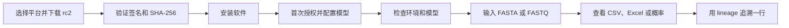
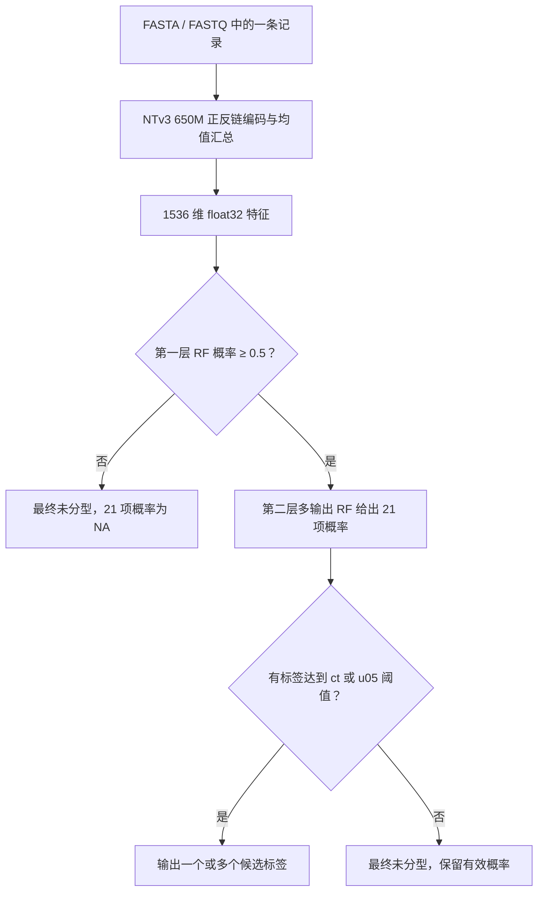

# IncFinder 0.5.0rc2

[English](README.md) · **简体中文**

IncFinder 对 FASTA 或 FASTQ 中的每条序列给出候选质粒不相容群（Inc）标签。运行后打开 **inc_results.csv** 即可逐条查看分型，也可以继续查看概率和结果来源。

**科研预览版** · [rc2 签名发行包](https://github.com/chrisjack007/IncFinder_showcase/releases/tag/v0.5.0rc2) · [模型卡](https://github.com/chrisjack007/IncFinder_showcase/blob/v0.5.0rc2/docs/MODEL_CARD.zh-CN.md) · [输入输出示例](#sample-results) · [软件架构](#rc2-architecture)

## 快速开始

按版本和平台下载**一个脚本**。原版使用 Conda，便携版自带运行环境。使用 Docker 时，先启动 Linux 容器引擎。

| 平台（x86-64） | 原版 rc2 | 便携版 rc2 | 打开菜单 |
| --- | --- | --- | --- |
| Windows | [下载 Windows 脚本](https://github.com/chrisjack007/IncFinder_showcase/releases/download/v0.5.0rc2/IncFinder-Start.cmd) | [下载 Windows 脚本](https://github.com/chrisjack007/IncFinder_showcase/releases/download/v0.5.0rc2-portable.1/IncFinder-Start.cmd) | 双击 `IncFinder-Start.cmd` |
| WSL2 | [下载 WSL2 脚本](https://github.com/chrisjack007/IncFinder_showcase/releases/download/v0.5.0rc2/incfinder-start.sh) | [下载 WSL2 脚本](https://github.com/chrisjack007/IncFinder_showcase/releases/download/v0.5.0rc2-portable.1/incfinder-start.sh) | 在 WSL2 内运行 `bash incfinder-start.sh` |
| 原生 Linux | [下载 Linux 脚本](https://github.com/chrisjack007/IncFinder_showcase/releases/download/v0.5.0rc2/incfinder-start.sh) | [下载 Linux 脚本](https://github.com/chrisjack007/IncFinder_showcase/releases/download/v0.5.0rc2-portable.1/incfinder-start.sh) | 运行 `bash incfinder-start.sh` |
| Docker | [Windows 宿主](https://github.com/chrisjack007/IncFinder_showcase/releases/download/v0.5.0rc2/IncFinder-Start.cmd) · [Linux 宿主](https://github.com/chrisjack007/IncFinder_showcase/releases/download/v0.5.0rc2/incfinder-start.sh) | [Windows 宿主](https://github.com/chrisjack007/IncFinder_showcase/releases/download/v0.5.0rc2-portable.1/IncFinder-Start.cmd) · [Linux 宿主](https://github.com/chrisjack007/IncFinder_showcase/releases/download/v0.5.0rc2-portable.1/incfinder-start.sh) | 打开宿主脚本，运行方式选 **2 · Docker** |

**首次使用，先选运行方式，再选菜单 2“安装并试跑”。** 本机运行时在第一个提示按 Enter，使用 Docker 时输入 2。 脚本会下载并核对安装包签名与 SHA-256，准备环境和官方模型，依次执行 `version`、`doctor`、`models verify`，然后分析随包 `sample.fasta` 的两条记录。完成后，终端会显示两条分型结果以及 CSV 和 Excel 的完整路径。默认使用 CPU、批大小 1、4 个线程、1 个 RF 任务，原始序列编码的跨平台等价状态记为 `NOT_ESTABLISHED`。

| 菜单 | 短命令 | 用途 |
| --- | --- | --- |
| 1 下载 | `download` | 校验并解压对应的软件包，适合提前准备。 |
| 2 安装并试跑 | `install` | 完成配置，用官方 `ct` 阈值跑通随包 FASTA。 |
| 3 使用 | `run` | 输入 FASTA、FASTQ 或 gzip 文件路径。Windows 也可按 Enter 打开文件选择框。每次运行写入新目录。 |
| 4 修改配置 | `config` | 修改默认参数、切换已校验的模型目录，或给已有结果换一套阈值重新判读。 |

要分析自己的文件，也可以在脚本所在目录直接运行一行命令。使用 Docker 时，在 `run` 前加 `--docker`。

```powershell
.\IncFinder-Start.cmd run reads.fasta
```

```bash
bash incfinder-start.sh run reads.fasta
```

**模型与离线使用。** 首次准备模型前，请先取得 NTv3 访问权限。官方模型约 27.36 GB，建议首次准备时预留 60 GB 空间。令牌只在官方交互登录提示中输入。两版可共用一个已通过哈希校验的模型目录。原版提示缺少 Conda 时，先安装 Conda，再打开脚本接着运行。准备完成后，预测和阈值重判均可离线运行。[NTv3 授权入口](https://huggingface.co/InstaDeepAI/NTv3_650M_pre) · [Miniforge](https://github.com/conda-forge/miniforge)

**阈值与结果。** 菜单 4 的修改可以保存为该版本和平台的默认值，也可仅用于下次运行。`ct` 使用官方逐类阈值，`0.5` 对应官方 `u05`。自定义时，可以设置 [0, 1] 内的统一阈值、按类别名修改，或导出并重新导入完整的 21 行 UTF-8 TSV。选择“对已有结果重新判读”，输入已完成的 rc2 结果目录，即可直接使用原始概率计算。新建的 `review-…` 目录包含分型汇总 CSV、21 项判定 CSV、实际阈值、三个工作表的 Excel，以及记录原运行 ID 和文件摘要的 `review.json`。第一层仍需达到 0.5 才会进入第二层。[官方阈值表](https://github.com/chrisjack007/IncFinder_showcase/blob/v0.5.0rc2/NT_V3_650M_TSRF_SW/config/thresholds.tsv)

脚本会先核对本机启动程序的 SHA-256。离线准备时，可预先将同一发行页的对应启动程序放在脚本旁。软件包继续使用原有签名清单。[原版启动器校验清单](https://github.com/chrisjack007/IncFinder_showcase/releases/download/v0.5.0rc2/LAUNCHER-SHA256SUMS) · [便携版启动器校验清单](https://github.com/chrisjack007/IncFinder_showcase/releases/download/v0.5.0rc2-portable.1/LAUNCHER-SHA256SUMS) · [原版签名](https://github.com/chrisjack007/IncFinder_showcase/releases/download/v0.5.0rc2/LAUNCHER-SHA256SUMS.sig) · [便携版签名](https://github.com/chrisjack007/IncFinder_showcase/releases/download/v0.5.0rc2-portable.1/LAUNCHER-SHA256SUMS.sig) · [启动器源码](launcher/)

<details>
<summary>常用配置短命令与离线准备</summary>

下表是启动脚本名后面的参数。双击打开菜单也能完成这些操作。

| 用途 | 参数 |
| --- | --- |
| 查看当前设置 | `config show` |
| 仅下次切换到统一 0.5 | `config --once threshold 0.5` |
| 导出或导入 21 项阈值 | `config export thresholds.tsv` 或 `config import thresholds.tsv` |
| 恢复默认设置 | `config reset` |
| 用当前阈值重判已有结果 | `review "结果目录"` |

默认结果写入用户主目录下的 `IncFinder/results/<发行标签>/<平台>/`。如需离线解压，让 `INCFINDER_START_ASSETS` 指向已下载的本版安装包目录。原版还需要已准备的锁定 Conda 环境或依赖缓存。Docker 的默认模型卷为 `incfinder-rc2-model-store`，也可用 `INCFINDER_START_MODEL_VOLUME` 指定包含 `models/` 的数据卷。

</details>

## 手动安装与运行

选择平台后，从一个可写工作目录开始，在同一终端中按顺序复制命令。各平台都使用签名包内的两条示例序列，跑完即可对照下方结果。

| 平台 | 原 rc2 安装包 | 可复制命令 | 使用视频 · WebM |
| --- | --- | --- | --- |
| Windows x64 | [Windows ZIP](https://github.com/chrisjack007/IncFinder_showcase/releases/download/v0.5.0rc2/incfinder-0.5.0rc2-win-64.zip) | [PowerShell](#windows) | [Windows 实录](https://chrisjack007.github.io/IncFinder_showcase/docs/media/rc2/windows.webm) |
| WSL2 x64 | [Linux TAR.GZ](https://github.com/chrisjack007/IncFinder_showcase/releases/download/v0.5.0rc2/incfinder-0.5.0rc2-linux-64.tar.gz) | [WSL Bash](#wsl2) | [WSL2 实录](https://chrisjack007.github.io/IncFinder_showcase/docs/media/rc2/wsl2.webm) |
| 原生 Linux x64 | [Linux TAR.GZ](https://github.com/chrisjack007/IncFinder_showcase/releases/download/v0.5.0rc2/incfinder-0.5.0rc2-linux-64.tar.gz) | [Bash](#linux) | [原生 Linux 实录](https://chrisjack007.github.io/IncFinder_showcase/docs/media/rc2/linux.webm) |
| Docker linux/amd64 | [Linux TAR.GZ](https://github.com/chrisjack007/IncFinder_showcase/releases/download/v0.5.0rc2/incfinder-0.5.0rc2-linux-64.tar.gz) | [Docker Desktop / PowerShell](#docker) | [Docker 实录](https://chrisjack007.github.io/IncFinder_showcase/docs/media/rc2/docker.webm) |

四段视频回放各平台实际执行的命令和终端输出，配中英字幕。演示复用已校验的模型目录，耗时等待已剪短。[下载视频文件](docs/media/rc2/)

另有解压运行的 **portable.1** 发行包。该版 Docker 的单行溯源需要重新挂载原始输入，发行页附有对应命令。[便携版下载和 Docker 溯源说明](https://github.com/chrisjack007/IncFinder_showcase/releases/tag/v0.5.0rc2-portable.1)

<a id="rc2-workflow"></a>

### 从下载到查看结果



### 安装前准备

原生安装使用已初始化 Conda 的终端，并准备 curl、tar 和支持 `-Y verify` 的 OpenSSH `ssh-keygen`。Windows 使用 `curl.exe` 和 `Expand-Archive`。Docker Desktop 选择 Linux 容器引擎。首次安装使用新环境 `IncFinder_Test1`，已有经核验的 rc2 环境可激活后从模型配置开始。[Miniforge](https://github.com/conda-forge/miniforge)

首次准备模型前，先在 Hugging Face 官方模型页取得访问权限。安装器从本次 GitHub 发行获取两层 RF，从 Hugging Face 获取固定修订的编码器文件。模型合计约 **27.36 GB**，建议模型所在文件系统至少有 **60 GB 可用空间**，另为软件环境、结果或 Docker 镜像留出空间。模型准备好后可离线分析。登录时在交互提示中输入自己的令牌。[NTv3 650M](https://huggingface.co/InstaDeepAI/NTv3_650M_pre) · [固定修订的模型实现](https://huggingface.co/InstaDeepAI/ntv3_base_model/tree/27682ed2f537a4c4fcc356b6b8201e7dfceca602)

下方命令固定发行公钥文件的 SHA-256，先验证 `SHA256SUMS` 的分离签名，再核对所选安装包。成功时会看到签名者 `incfinder-release`、ED25519 公钥指纹 `SHA256:MoIhr1BXeQBxbBFtycnWNica1CWnm/uguMkVGUnJGXY`，以及所选安装包的 `OK`。[登记的发行公钥](https://github.com/chrisjack007/IncFinder_showcase/blob/046307df31d02dd5e66986f73f22bcad0b58eab7/licenses/incfinder-release-allowed-signers)

## Windows

<details>
<summary>Windows 手动安装、检查与预测命令</summary>

在 Windows x64 上打开可激活 Conda 环境的 PowerShell。 [观看本平台实录](https://chrisjack007.github.io/IncFinder_showcase/docs/media/rc2/windows.webm)

**1. 下载、验签和解压**

<details>
<summary>展开可复制的下载命令</summary>

```powershell
$ErrorActionPreference = 'Stop'
$work = Join-Path $PWD ('incfinder-rc2-' + [guid]::NewGuid().ToString('N').Substring(0,8))
New-Item -ItemType Directory -Path $work | Out-Null
Set-Location -LiteralPath $work
$archive = 'incfinder-0.5.0rc2-win-64.zip'
$release = 'https://github.com/chrisjack007/IncFinder_showcase/releases/download/v0.5.0rc2'
foreach ($name in @($archive, 'SHA256SUMS', 'SHA256SUMS.sig', 'allowed_signers')) {
    curl.exe --fail --location --silent --show-error --connect-timeout 15 --max-time 120 --retry 2 --output $name "$release/$name"
    if ($LASTEXITCODE) { throw "Download failed for $name" }
}
$keyHash = '25ad764a353930a61b951e12bf431d9a01e7a36a9136acf3331df360e0a47f4b'
if ((Get-FileHash -Algorithm SHA256 -LiteralPath allowed_signers).Hash -ne $keyHash) { throw "Unexpected release signing key" }
cmd.exe /d /c "ssh-keygen -Y verify -f allowed_signers -I incfinder-release -n incfinder-release -s SHA256SUMS.sig < SHA256SUMS"
if ($LASTEXITCODE) { throw 'Release signature verification failed' }
$record = @(Get-Content -LiteralPath SHA256SUMS | Where-Object { ($_ -split '\s+', 2)[1] -ceq $archive })
if ($record.Count -ne 1 -or (Get-FileHash -Algorithm SHA256 -LiteralPath $archive).Hash -ne ($record[0] -split '\s+', 2)[0]) { throw "SHA-256 mismatch for $archive" }
Write-Output "$archive OK"
Expand-Archive -LiteralPath $archive -DestinationPath .
Set-Location -LiteralPath incfinder-0.5.0rc2
```

</details>

**2. 在 Conda 环境中安装 IncFinder**

```powershell
conda create --override-channels -c conda-forge -n IncFinder_Test1 --file environments/win-64.lock
if ($LASTEXITCODE) { throw 'Environment creation failed' }
conda activate IncFinder_Test1
if (-not $env:CONDA_PREFIX -or (Split-Path -Leaf $env:CONDA_PREFIX) -ine 'IncFinder_Test1') { throw 'Activate IncFinder_Test1 first' }
conda install --offline --override-channels -c conda-forge ./dist/channel/noarch/incfinder-0.5.0rc2-py_0.conda
if ($LASTEXITCODE) { throw 'IncFinder installation failed' }
```

**3. 配置模型与结果目录**

默认模型目录为解压目录下的 `models`。若复用已有模型，在执行本段前将 `INCFINDER_MODEL_DIR` 设为已校验目录。每次会话都会创建新的结果目录。

```powershell
$Models = if ($env:INCFINDER_MODEL_DIR) { $env:INCFINDER_MODEL_DIR } else { Join-Path $PWD 'models' }
$Runs = Join-Path $HOME ('incfinder-results/run-' + [guid]::NewGuid().ToString('N').Substring(0,8))
New-Item -ItemType Directory -Path $Runs -Force | Out-Null
```

首次安装模型时，取得官方授权后执行下列命令。复用已校验缓存时可直接进入检查步骤。

```powershell
hf auth login
incfinder models install --model-dir "$Models" --download-rf --download-ntv3
```

**4. 检查软件与模型**

`version` 应显示 `incfinder 0.5.0rc2`。`doctor` 检查依赖、软件资源和模型文件大小。`models verify` 读取完整模型并核对 SHA-256。两项都应输出 `PASS`，完整 JSON 报告保存在结果目录。

```powershell
incfinder version
incfinder doctor --model-dir "$Models" > "$Runs/doctor.json"
(Get-Content -Raw "$Runs/doctor.json" | ConvertFrom-Json).status
incfinder models verify --model-dir "$Models" > "$Runs/verify.json"
(Get-Content -Raw "$Runs/verify.json" | ConvertFrom-Json).status
```

**5. 运行 FASTA 和 FASTQ 示例**

第一条使用默认 `ct` 阈值，第二条使用 `u05`，分别写入新目录。`--allow-encoder-drift` 表示接受原始序列编码在不同平台可能出现的差异，运行摘要中的科学等价状态记为 `NOT_ESTABLISHED`。

```powershell
incfinder predict examples/sample.fasta --model-dir "$Models" --device cpu --batch-size 1 --threads 4 --jobs 1 --allow-encoder-drift --output "$Runs/fasta-ct" > "$Runs/fasta-ct.json"
incfinder predict examples/sample.fastq --model-dir "$Models" --device cpu --batch-size 1 --threads 4 --jobs 1 --allow-encoder-drift --threshold-mode u05 --output "$Runs/fastq-u05" > "$Runs/fastq-u05.json"
```

<details>
<summary>补齐每种格式的两种阈值模式（可选）</summary>

```powershell
incfinder predict examples/sample.fasta --model-dir "$Models" --device cpu --batch-size 1 --threads 4 --jobs 1 --allow-encoder-drift --threshold-mode u05 --output "$Runs/fasta-u05" > "$Runs/fasta-u05.json"
incfinder predict examples/sample.fastq --model-dir "$Models" --device cpu --batch-size 1 --threads 4 --jobs 1 --allow-encoder-drift --output "$Runs/fastq-ct" > "$Runs/fastq-ct.json"
```

</details>

**6. 打开分型结果并追溯第 0 行**

```powershell
Import-Csv "$Runs/fasta-ct/inc_results.csv" | Format-Table row_index,Header,Result,gate_pass,internal_status -AutoSize
incfinder lineage "$Runs/fasta-ct" --row 0 > "$Runs/lineage.json"
(Get-Content -Raw "$Runs/lineage.json" | ConvertFrom-Json).row | Select-Object internal_status,gate_pass,called_labels | Format-List
```

打开结果目录下的 `fasta-ct/inc_predictions.xlsx`，即可在 Excel 中查看这两条记录。[对照示例结果](#sample-results)

</details>

## WSL2

<details>
<summary>WSL2 手动安装、检查与预测命令</summary>

在 WSL2 发行版内打开 Bash，先运行 `cd ~`。解压目录和结果目录都放在发行版自己的 Linux 文件系统。 [观看本平台实录](https://chrisjack007.github.io/IncFinder_showcase/docs/media/rc2/wsl2.webm)

**1. 下载、验签和解压**

<details>
<summary>展开可复制的下载命令</summary>

```bash
set -e -o pipefail
work=$(mktemp -d "$PWD/incfinder-rc2.XXXXXXXX")
cd "$work"
archive=incfinder-0.5.0rc2-linux-64.tar.gz
release=https://github.com/chrisjack007/IncFinder_showcase/releases/download/v0.5.0rc2
for name in "$archive" SHA256SUMS SHA256SUMS.sig allowed_signers; do
    curl --fail --location --silent --show-error --connect-timeout 15 --max-time 120 --retry 2 --output "$name" "$release/$name"
done
printf '%s  %s\n' 25ad764a353930a61b951e12bf431d9a01e7a36a9136acf3331df360e0a47f4b allowed_signers | sha256sum --check -
ssh-keygen -Y verify -f allowed_signers -I incfinder-release -n incfinder-release -s SHA256SUMS.sig < SHA256SUMS
awk -v name="$archive" '$2 == name {print}' SHA256SUMS > selected.sha256
test "$(wc -l < selected.sha256)" -eq 1
sha256sum --check selected.sha256
tar -xzf "$archive"
cd incfinder-0.5.0rc2
```

</details>

**2. 在 Conda 环境中安装 IncFinder**

```bash
set -e -o pipefail
conda create --override-channels -c conda-forge -n IncFinder_Test1 --file environments/linux-64.lock
conda activate IncFinder_Test1
conda install --offline --override-channels -c conda-forge ./dist/channel/noarch/incfinder-0.5.0rc2-py_0.conda
```

**3. 配置模型与结果目录**

默认模型目录为解压目录下的 `models`。若复用已有模型，在执行本段前将 `INCFINDER_MODEL_DIR` 设为已校验目录。每次会话都会创建新的结果目录。

```bash
models="${INCFINDER_MODEL_DIR:-$PWD/models}"
mkdir -p "$HOME/incfinder-results"
runs=$(mktemp -d "$HOME/incfinder-results/run.XXXXXXXX")
```

首次安装模型时，取得官方授权后执行下列命令。复用已校验缓存时可直接进入检查步骤。

```bash
hf auth login
incfinder models install --model-dir "$models" --download-rf --download-ntv3
```

**4. 检查软件与模型**

`version` 应显示 `incfinder 0.5.0rc2`。`doctor` 检查依赖、软件资源和模型文件大小。`models verify` 读取完整模型并核对 SHA-256。两项都应输出 `PASS`，完整 JSON 报告保存在结果目录。

```bash
incfinder version
incfinder doctor --model-dir "$models" > "$runs/doctor.json"
python -c 'import json, sys; print(json.load(open(sys.argv[1]))["status"])' "$runs/doctor.json"
incfinder models verify --model-dir "$models" > "$runs/verify.json"
python -c 'import json, sys; print(json.load(open(sys.argv[1]))["status"])' "$runs/verify.json"
```

**5. 运行 FASTA 和 FASTQ 示例**

第一条使用默认 `ct` 阈值，第二条使用 `u05`，分别写入新目录。`--allow-encoder-drift` 表示接受原始序列编码在不同平台可能出现的差异，运行摘要中的科学等价状态记为 `NOT_ESTABLISHED`。

```bash
incfinder predict examples/sample.fasta --model-dir "$models" --device cpu --batch-size 1 --threads 4 --jobs 1 --allow-encoder-drift --output "$runs/fasta-ct" > "$runs/fasta-ct.json"
incfinder predict examples/sample.fastq --model-dir "$models" --device cpu --batch-size 1 --threads 4 --jobs 1 --allow-encoder-drift --threshold-mode u05 --output "$runs/fastq-u05" > "$runs/fastq-u05.json"
```

<details>
<summary>补齐每种格式的两种阈值模式（可选）</summary>

```bash
incfinder predict examples/sample.fasta --model-dir "$models" --device cpu --batch-size 1 --threads 4 --jobs 1 --allow-encoder-drift --threshold-mode u05 --output "$runs/fasta-u05" > "$runs/fasta-u05.json"
incfinder predict examples/sample.fastq --model-dir "$models" --device cpu --batch-size 1 --threads 4 --jobs 1 --allow-encoder-drift --output "$runs/fastq-ct" > "$runs/fastq-ct.json"
```

</details>

**6. 打开分型结果并追溯第 0 行**

```bash
head -n 3 "$runs/fasta-ct/inc_results.csv"
incfinder lineage "$runs/fasta-ct" --row 0 > "$runs/lineage.json"
python -c 'import json, sys; r=json.load(open(sys.argv[1]))["row"]; print(r["internal_status"], r["gate_pass"], r["called_labels"])' "$runs/lineage.json"
```

打开结果目录下的 `fasta-ct/inc_predictions.xlsx`，即可在 Excel 中查看这两条记录。[对照示例结果](#sample-results)

</details>

## Linux

<details>
<summary>Linux 手动安装、检查与预测命令</summary>

在原生 x86-64 Linux 上打开可激活 Conda 环境的 Bash。 [观看本平台实录](https://chrisjack007.github.io/IncFinder_showcase/docs/media/rc2/linux.webm)

**1. 下载、验签和解压**

<details>
<summary>展开可复制的下载命令</summary>

```bash
set -e -o pipefail
work=$(mktemp -d "$PWD/incfinder-rc2.XXXXXXXX")
cd "$work"
archive=incfinder-0.5.0rc2-linux-64.tar.gz
release=https://github.com/chrisjack007/IncFinder_showcase/releases/download/v0.5.0rc2
for name in "$archive" SHA256SUMS SHA256SUMS.sig allowed_signers; do
    curl --fail --location --silent --show-error --connect-timeout 15 --max-time 120 --retry 2 --output "$name" "$release/$name"
done
printf '%s  %s\n' 25ad764a353930a61b951e12bf431d9a01e7a36a9136acf3331df360e0a47f4b allowed_signers | sha256sum --check -
ssh-keygen -Y verify -f allowed_signers -I incfinder-release -n incfinder-release -s SHA256SUMS.sig < SHA256SUMS
awk -v name="$archive" '$2 == name {print}' SHA256SUMS > selected.sha256
test "$(wc -l < selected.sha256)" -eq 1
sha256sum --check selected.sha256
tar -xzf "$archive"
cd incfinder-0.5.0rc2
```

</details>

**2. 在 Conda 环境中安装 IncFinder**

```bash
set -e -o pipefail
conda create --override-channels -c conda-forge -n IncFinder_Test1 --file environments/linux-64.lock
conda activate IncFinder_Test1
conda install --offline --override-channels -c conda-forge ./dist/channel/noarch/incfinder-0.5.0rc2-py_0.conda
```

**3. 配置模型与结果目录**

默认模型目录为解压目录下的 `models`。若复用已有模型，在执行本段前将 `INCFINDER_MODEL_DIR` 设为已校验目录。每次会话都会创建新的结果目录。

```bash
models="${INCFINDER_MODEL_DIR:-$PWD/models}"
mkdir -p "$HOME/incfinder-results"
runs=$(mktemp -d "$HOME/incfinder-results/run.XXXXXXXX")
```

首次安装模型时，取得官方授权后执行下列命令。复用已校验缓存时可直接进入检查步骤。

```bash
hf auth login
incfinder models install --model-dir "$models" --download-rf --download-ntv3
```

**4. 检查软件与模型**

`version` 应显示 `incfinder 0.5.0rc2`。`doctor` 检查依赖、软件资源和模型文件大小。`models verify` 读取完整模型并核对 SHA-256。两项都应输出 `PASS`，完整 JSON 报告保存在结果目录。

```bash
incfinder version
incfinder doctor --model-dir "$models" > "$runs/doctor.json"
python -c 'import json, sys; print(json.load(open(sys.argv[1]))["status"])' "$runs/doctor.json"
incfinder models verify --model-dir "$models" > "$runs/verify.json"
python -c 'import json, sys; print(json.load(open(sys.argv[1]))["status"])' "$runs/verify.json"
```

**5. 运行 FASTA 和 FASTQ 示例**

第一条使用默认 `ct` 阈值，第二条使用 `u05`，分别写入新目录。`--allow-encoder-drift` 表示接受原始序列编码在不同平台可能出现的差异，运行摘要中的科学等价状态记为 `NOT_ESTABLISHED`。

```bash
incfinder predict examples/sample.fasta --model-dir "$models" --device cpu --batch-size 1 --threads 4 --jobs 1 --allow-encoder-drift --output "$runs/fasta-ct" > "$runs/fasta-ct.json"
incfinder predict examples/sample.fastq --model-dir "$models" --device cpu --batch-size 1 --threads 4 --jobs 1 --allow-encoder-drift --threshold-mode u05 --output "$runs/fastq-u05" > "$runs/fastq-u05.json"
```

<details>
<summary>补齐每种格式的两种阈值模式（可选）</summary>

```bash
incfinder predict examples/sample.fasta --model-dir "$models" --device cpu --batch-size 1 --threads 4 --jobs 1 --allow-encoder-drift --threshold-mode u05 --output "$runs/fasta-u05" > "$runs/fasta-u05.json"
incfinder predict examples/sample.fastq --model-dir "$models" --device cpu --batch-size 1 --threads 4 --jobs 1 --allow-encoder-drift --output "$runs/fastq-ct" > "$runs/fastq-ct.json"
```

</details>

**6. 打开分型结果并追溯第 0 行**

```bash
head -n 3 "$runs/fasta-ct/inc_results.csv"
incfinder lineage "$runs/fasta-ct" --row 0 > "$runs/lineage.json"
python -c 'import json, sys; r=json.load(open(sys.argv[1]))["row"]; print(r["internal_status"], r["gate_pass"], r["called_labels"])' "$runs/lineage.json"
```

打开结果目录下的 `fasta-ct/inc_predictions.xlsx`，即可在 Excel 中查看这两条记录。[对照示例结果](#sample-results)

</details>

## Docker

<details>
<summary>Docker 手动安装、检查与预测命令</summary>

以下命令在 Windows 宿主的 PowerShell 中执行，Docker Desktop 使用 Linux 容器引擎。镜像自带 Conda 环境，构建目录取自已签名的 Linux 安装包。 [观看本平台实录](https://chrisjack007.github.io/IncFinder_showcase/docs/media/rc2/docker.webm)

**1. 下载、验签和解压**

<details>
<summary>展开可复制的下载命令</summary>

```powershell
$ErrorActionPreference = 'Stop'
$work = Join-Path $PWD ('incfinder-rc2-' + [guid]::NewGuid().ToString('N').Substring(0,8))
New-Item -ItemType Directory -Path $work | Out-Null
Set-Location -LiteralPath $work
$archive = 'incfinder-0.5.0rc2-linux-64.tar.gz'
$release = 'https://github.com/chrisjack007/IncFinder_showcase/releases/download/v0.5.0rc2'
foreach ($name in @($archive, 'SHA256SUMS', 'SHA256SUMS.sig', 'allowed_signers')) {
    curl.exe --fail --location --silent --show-error --connect-timeout 15 --max-time 120 --retry 2 --output $name "$release/$name"
    if ($LASTEXITCODE) { throw "Download failed for $name" }
}
$keyHash = '25ad764a353930a61b951e12bf431d9a01e7a36a9136acf3331df360e0a47f4b'
if ((Get-FileHash -Algorithm SHA256 -LiteralPath allowed_signers).Hash -ne $keyHash) { throw "Unexpected release signing key" }
cmd.exe /d /c "ssh-keygen -Y verify -f allowed_signers -I incfinder-release -n incfinder-release -s SHA256SUMS.sig < SHA256SUMS"
if ($LASTEXITCODE) { throw 'Release signature verification failed' }
$record = @(Get-Content -LiteralPath SHA256SUMS | Where-Object { ($_ -split '\s+', 2)[1] -ceq $archive })
if ($record.Count -ne 1 -or (Get-FileHash -Algorithm SHA256 -LiteralPath $archive).Hash -ne ($record[0] -split '\s+', 2)[0]) { throw "SHA-256 mismatch for $archive" }
Write-Output "$archive OK"
tar.exe -xzf $archive
if ($LASTEXITCODE) { throw 'Archive extraction failed' }
Set-Location -LiteralPath incfinder-0.5.0rc2
```

</details>

**2. 用签名包构建镜像**

```powershell
$Image = 'incfinder-guide:0.5.0rc2'
docker build --platform linux/amd64 -t $Image .
if ($LASTEXITCODE) { throw 'Docker image build failed' }
```

**3. 配置模型、输入与输出挂载**

首次安装使用 Linux 数据卷，同时容纳 `/store/models` 和同级暂存目录。登录和模型安装在同一个临时容器内完成。后续推理只读挂载模型卷。

```powershell
$ModelVolume = 'incfinder-rc2-model-store'
docker volume create $ModelVolume
if ($LASTEXITCODE) { throw 'Could not create the model volume' }
docker run --rm -it --mount "type=volume,source=$ModelVolume,target=/store" -e HF_HUB_OFFLINE=0 -e TRANSFORMERS_OFFLINE=0 --entrypoint conda $Image run --no-capture-output -n IncFinder_Test1 bash -c "hf auth login && incfinder models install --model-dir /store/models --download-rf --download-ntv3"
if ($LASTEXITCODE) { throw 'Model installation failed' }
$ModelMount = "type=volume,source=$ModelVolume,target=/store,readonly"
```

宿主机已有校验过的模型时，可将 `INCFINDER_MODEL_DIR` 设为其绝对路径，并使用以下代码块。Docker 实录采用了此方式。

```powershell
$Models = (Resolve-Path -LiteralPath $env:INCFINDER_MODEL_DIR).Path
$ModelMount = "type=bind,source=$Models,target=/store/models,readonly"
```

示例输入只读挂载。每次会话新建一个 Linux 结果卷和一个宿主机结果目录。

```powershell
$Inputs = (Resolve-Path -LiteralPath 'examples').Path
$Volume = 'incfinder-rc2-results-' + [guid]::NewGuid().ToString('N').Substring(0,8)
$Runs = Join-Path $HOME ('incfinder-results/' + $Volume)
New-Item -ItemType Directory -Path $Runs -Force | Out-Null
docker volume create $Volume
if ($LASTEXITCODE) { throw 'Could not create the results volume' }
$Mounts = @('--rm','--network','none','--mount',$ModelMount,'--mount',"type=bind,source=$Inputs,target=/inputs,readonly",'--mount',"type=volume,source=$Volume,target=/results")
```

**4. 检查软件与模型**

`version` 应显示 `incfinder 0.5.0rc2`。`doctor` 检查依赖、软件资源和模型文件大小。`models verify` 读取完整模型并核对 SHA-256。两项都应输出 `PASS`，完整 JSON 报告保存在结果目录。

```powershell
docker run @Mounts $Image version
docker run @Mounts $Image doctor --model-dir /store/models > "$Runs/doctor.json"
(Get-Content -Raw "$Runs/doctor.json" | ConvertFrom-Json).status
docker run @Mounts $Image models verify --model-dir /store/models > "$Runs/verify.json"
(Get-Content -Raw "$Runs/verify.json" | ConvertFrom-Json).status
```

**5. 运行 FASTA 和 FASTQ 示例**

第一条使用默认 `ct` 阈值，第二条使用 `u05`，分别写入新目录。`--allow-encoder-drift` 表示接受原始序列编码在不同平台可能出现的差异，运行摘要中的科学等价状态记为 `NOT_ESTABLISHED`。

```powershell
docker run @Mounts $Image predict /inputs/sample.fasta --model-dir /store/models --device cpu --batch-size 1 --threads 4 --jobs 1 --allow-encoder-drift --output /results/fasta-ct > "$Runs/fasta-ct.json"
docker run @Mounts $Image predict /inputs/sample.fastq --model-dir /store/models --device cpu --batch-size 1 --threads 4 --jobs 1 --allow-encoder-drift --threshold-mode u05 --output /results/fastq-u05 > "$Runs/fastq-u05.json"
```

<details>
<summary>补齐每种格式的两种阈值模式（可选）</summary>

```powershell
docker run @Mounts $Image predict /inputs/sample.fasta --model-dir /store/models --device cpu --batch-size 1 --threads 4 --jobs 1 --allow-encoder-drift --threshold-mode u05 --output /results/fasta-u05 > "$Runs/fasta-u05.json"
docker run @Mounts $Image predict /inputs/sample.fastq --model-dir /store/models --device cpu --batch-size 1 --threads 4 --jobs 1 --allow-encoder-drift --output /results/fastq-ct > "$Runs/fastq-ct.json"
```

</details>

**6. 打开分型结果并追溯第 0 行**

先将卷中的结果取回宿主机。查询溯源时沿用容器内的原始输入路径 `/inputs`。复制完成后移除用于读取结果的临时容器。

```powershell
$reader = docker create --mount "type=volume,source=$Volume,target=/results,readonly" $Image version
if ($LASTEXITCODE -ne 0) { throw "Could not open the results volume" }
docker cp "${reader}:/results/." "$Runs"
if ($LASTEXITCODE -ne 0) { throw "Could not copy results" }
docker rm $reader | Out-Null
```

```powershell
Import-Csv "$Runs/fasta-ct/inc_results.csv" | Format-Table row_index,Header,Result,gate_pass,internal_status -AutoSize
docker run @Mounts $Image lineage /results/fasta-ct --row 0 > "$Runs/lineage.json"
(Get-Content -Raw "$Runs/lineage.json" | ConvertFrom-Json).row | Select-Object internal_status,gate_pass,called_labels | Format-List
```

打开结果目录下的 `fasta-ct/inc_predictions.xlsx`，即可在 Excel 中查看这两条记录。[对照示例结果](#sample-results)

在 Linux 宿主机上使用 Docker Engine 时，可参照标签版文档中用 Bash 挂载只读模型和输入的示例。[Docker / Bash](https://github.com/chrisjack007/IncFinder_showcase/blob/v0.5.0rc2/README.zh-CN.md)

</details>

<a id="sample-results"></a>

## 输入和输出是什么样

签名包内的 FASTA 和 FASTQ 含有相同的两条记录，长度分别为 **889 bp** 和 **901 bp**。下表摘录第 1 条的前 20 个碱基，运行示例请使用完整文件。CLI 也支持 gzip 压缩的 FASTA 和 FASTQ。

| [sample.fasta](https://github.com/chrisjack007/IncFinder_showcase/blob/v0.5.0rc2/NT_V3_650M_TSRF_SW/examples/sample.fasta) | [sample.fastq](https://github.com/chrisjack007/IncFinder_showcase/blob/v0.5.0rc2/NT_V3_650M_TSRF_SW/examples/sample.fastq) |
| --- | --- |
| `>test_frag_000000001`<br>`TGCTTCTTCATTACGCCGGT…` | `@test_frag_000000001`<br>`TGCTTCTTCATTACGCCGGT…`<br>`+`<br>`IIIIIIIIIIIIIIIIIIII…` |

**`sample.fasta` 在默认 `ct` 下的 `inc_results.csv` 节选**

| row_index | Header | Result | final_status | predicted_label_count | gate_pass | internal_status |
| --- | --- | --- | --- | --- | --- | --- |
| 0 | test_frag_000000001 | `IncFIA;IncFIB;IncFII` | Inc_classified | 3 | 1 | Inc_called |
| 1 | test_frag_000000002 | Inc Unclassified | Inc_unclassified | 0 | 0 | Unclassified |

第 0 行通过第一层。切换到 `u05` 后，它仍通过第一层，但 21 项概率均未达到 0.5，因此 `Result` 变成 `Inc Unclassified`，`internal_status` 变成 `Inc_no_call`。第 1 行在两种模式下均未通过第一层，其 21 项第二层概率在 CSV/XLSX 中为 `NA`，在 NPZ 中为 `NaN`。`row_index` 从 0 起，保持输入顺序。[两条原始序列的分平台 CPU 参考](https://github.com/chrisjack007/IncFinder_showcase/blob/v0.5.0rc2/NT_V3_650M_TSRF_SW/examples/expected_outputs/raw_cpu.json)

`expected_outputs` 下的 `ct/` 和 `u05/` 目录保存另一组 11 条冻结特征回归结果。核对上述两条原始序列时，请使用 `raw_cpu.json` 中对应平台的数值。

| 输出文件 | 查看内容 |
| --- | --- |
| `inc_results.csv` | 每条输入的最终标签、标签数、第一层门控和内部状态。 |
| `layer1_decisions.csv` / `layer2_probabilities.csv` | 第一层分数与决定，以及按固定标签顺序排列的 21 项第二层概率。 |
| `inc_label_predictions.csv` | 指定阈值模式下每个 Inc 标签的二元判定。 |
| `inc_predictions.xlsx` | 四个工作表依次为 `Stage1`、`Stage2_probability`、`Inc_prediction` 和 `Inc_result`。 |
| `probabilities.npz` | 供程序读取的数组，包括第一层 `(N,)`、第二层 `(N,21)`、门控和最终标签矩阵。 |
| `run_summary.json` / `prediction.json` | 运行摘要记录输入摘要、执行状态和模型来源。预测记录保存实际阈值和计数。 |

分析自己的数据时，替换输入文件名并选择新的输出目录。Docker 需把输入所在目录只读挂载到 `/inputs`，命令中使用容器内路径。下次查询溯源时，将同一原始输入保留在相同路径。

<a id="rc2-architecture"></a>

## rc2 如何完成分型



编码器对原始碱基位置的最后一层表示取均值，再平均正向和反向互补序列的表示。第一层以 0.5 为门控阈值。第二层是多输出随机森林。默认 `ct` 的 21 个逐类阈值来自训练集的折外预测。`u05` 对全部标签使用 0.5。两层都按大于等于阈值判定。[编码与 RF 合同](https://github.com/chrisjack007/IncFinder_showcase/blob/v0.5.0rc2/NT_V3_650M_TSRF_SW/config/contract.json) · [输出合同](https://github.com/chrisjack007/IncFinder_showcase/blob/v0.5.0rc2/NT_V3_650M_TSRF_SW/config/output_contract.json)

训练序列长度范围为 **200–10,000 bp**。在此前已用于版本比较的留出集上，200,095 条记录覆盖 9,236 个质粒组，`ct` 的 Micro-F1 / Macro-F1 为 **0.579 / 0.445**，`u05` 为 **0.521 / 0.351**。两种模式都只检出 **326 条 Inc18 参考阳性中的 1 条**，未检出不足以排除 Inc18。[逐类结果与模型卡](https://github.com/chrisjack007/IncFinder_showcase/blob/v0.5.0rc2/docs/MODEL_CARD.zh-CN.md)

## 安装与运行问题

- **模型访问。** Hugging Face 返回 401/403 时，检查当前账号是否已经取得官方模型访问权，并用该账号交互登录。Docker 的模型安装命令会在这一次容器会话中启用联网。[官方授权页](https://huggingface.co/InstaDeepAI/NTv3_650M_pre)
- **GitHub 下载中断或限流。** 可重新运行模型安装命令。匿名 API 配额耗尽时，将同一发行页的 `stage1.joblib` 和 `stage2.joblib.part-001` 至 `part-022` 下载到 `rf-parts`，从解压目录执行 `incfinder models install --model-dir ./models --parts-dir ./rf-parts --download-ntv3`。安装器会核对各分卷和两层完整 RF。[发行附件](https://github.com/chrisjack007/IncFinder_showcase/releases/tag/v0.5.0rc2)
- **路径。** 每次 `predict` 都需要新的输出目录。Windows 使用较短的可写路径，WSL2 将结果写入原生 Linux 文件系统，Docker Desktop 将结果写入 Linux 数据卷后用 `docker cp` 取回。
- **wheel 安装。** 若使用新建的平台锁定环境，也可从签名解压目录执行 `python -m pip install --no-deps ./dist/wheels/incfinder_ntv3_tsrf-0.5.0rc2-py3-none-any.whl`。

[科研使用许可](https://github.com/chrisjack007/IncFinder_showcase/blob/v0.5.0rc2/NT_V3_650M_TSRF_SW/LICENSE) · [第三方声明](https://chrisjack007.github.io/IncFinder_showcase/notices.html)
