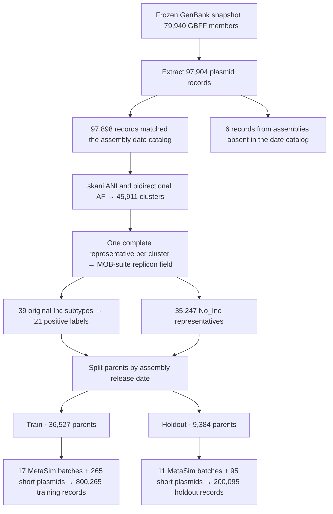

# Where the 21 IncFinder rc2 Inc labels come from

[简体中文](README.zh-CN.md) · [Software home](../README.md) · [Provenance data release](https://github.com/chrisjack007/IncFinder_showcase/releases/tag/v0.5.0rc2-provenance.1) · [Data dictionary](FIELDS.md)

The 21 positive labels originate from replicon calls on complete representative plasmids. The study first dereplicated GenBank plasmids, typed each representative with MOB-suite and grouped its Inc subtypes. It then split the representative plasmids by date and sampled them with MetaSim. A fragment inherits its parent's reference label. Establishing whether that fragment contains a replicon locus requires separate evidence. [rc2 model contract](../NT_V3_650M_TSRF_SW/config/contract.json)



## From GenBank to cluster representatives

The original record key combines a versioned assembly accession and a versioned sequence accession. The extraction rule accepted records with a plasmid qualifier in the source feature, or descriptions containing plasmid and excluding chromosome. The frozen date catalog contained 143,513 distinct assemblies. Six recovered records belonged to assemblies absent from it. Their rows are included in accessions.tsv.gz.

Each row is an assembly missing from the frozen date catalog. The left column identifies its versioned assembly accession. The right column lists the versioned plasmid sequence accessions excluded with it. Counting those accessions gives six records from two assemblies.

| Assembly | Sequence accessions excluded from dereplication |
|---|---|
| GCA_006228425.1 | CP030165.1 |
| GCA_029536795.1 | CP120578.1, CP120579.1, CP120580.1, CP120582.1, CP120583.1 |

The skani query list contained sequences of at least 500 bp. Clustering initialized a node for each of the 97,898 dated records. Distinct records were connected when ANI was ≥80% and the smaller of the reference and query alignment fractions was ≥90%. The historical total of 3,544,354 qualifying non-self search rows preserves search direction. Connected components yielded 45,911 clusters. Each cluster contributed the plasmid with the earliest assembly release date. Ties were resolved by greater sequence length, then historical FASTA path in lexical order. Compare complete member sets and representative accessions across runs. The numeric cluster IDs identify clusters within a view. [skani 0.3.1](https://github.com/bluenote-1577/skani/releases/tag/v0.3.1)

<a id="class-counts"></a>

## From the replicon field to 21 classes

MOB-suite 3.1.9 typed the complete representative plasmids. Only Inc subtypes entered the classification, with repeated occurrences of a subtype counted once per parent. The 7 May 2026 rules defined the categories over all representatives. [Archived rules of 7 May 2026](POLICY-SOURCES.md) · [All 39 subtype decisions](subtype-policy.tsv) · [Field definitions](FIELDS.md#subtype-policy) · [MOB-suite reference database](https://doi.org/10.5281/zenodo.10304948)

**Read down the rows for classes.** Each row is one final reference class. The first 21 follow rc2's stage-two output order. `No_Inc` in the last row means no Inc subtype was extracted from the complete parent. It is the stage-one negative reference class, so its stage-two index and original Inc subtypes are shown as `—`.

**Read across the seven columns.**

- **Stage-two index** is the position from 0 to 20 in the 21-value probability vector. **Final label** is the research category after merging. **Original Inc subtypes** lists the members extracted from MOB-suite's replicon field and assigned to that row.
- **Decision** identifies the count threshold or branch rule used. The 100-parent threshold counts distinct plasmids. **Representative plasmids** counts distinct parents carrying the final label among all 45,911 complete representatives. A parent counts once within a row.
- **Training records** counts records inheriting the label among 800,265 training records. **Holdout records** counts them among 200,095 holdout records. These columns include any label-bearing records among the 265 and 95 complete short plasmids added to the respective splits.

| Stage-two index | Final label | Original Inc subtypes | Decision | Representative plasmids | Training records | Holdout records |
|---:|---|---|---|---:|---:|---:|
| 0 | Inc18 | Inc18 | Single observed subtype in a major group with at least 100 parents | 115 | 1,493 | 326 |
| 1 | IncC | IncC | Single observed subtype in a major group with at least 100 parents | 348 | 7,773 | 1,839 |
| 2 | IncFIA | IncFIA | Subtype covers at least 100 parents in a multi-subtype group | 2,816 | 37,464 | 10,565 |
| 3 | IncFIB | IncFIB | Subtype covers at least 100 parents in a multi-subtype group | 4,144 | 80,158 | 17,969 |
| 4 | IncFIC | IncFIC | Subtype covers at least 100 parents in a multi-subtype group | 1,361 | 19,530 | 5,290 |
| 5 | IncFII | IncFII | Subtype covers at least 100 parents in a multi-subtype group | 3,122 | 51,585 | 12,765 |
| 6 | IncHI1 | IncHI1A, IncHI1B | Both branch members merge into IncHI1 | 715 | 18,416 | 4,035 |
| 7 | IncHI2 | IncHI2A | Branch member grouped under its parent | 310 | 10,987 | 2,224 |
| 8 | IncI | IncI-gamma/K1, IncI1, IncI1/B/O, IncI2 | A preliminary group remained below 100, so the IncI major group was pooled | 567 | 7,122 | 1,509 |
| 9 | IncK | IncK2/Z | Single observed subtype in a major group with at least 100 parents | 171 | 2,248 | 620 |
| 10 | IncL | IncL/M | Single observed subtype in a major group with at least 100 parents | 114 | 1,335 | 217 |
| 11 | IncN | IncN, IncN2 | Retain IncN and pool the rare IncN2 subtype into it | 464 | 5,813 | 1,161 |
| 12 | IncP | IncP | Single observed subtype in a major group with at least 100 parents | 295 | 5,200 | 1,152 |
| 13 | IncQ | IncQ1, IncQ2 | A preliminary group remained below 100, so the IncQ major group was pooled | 290 | 5,698 | 813 |
| 14 | IncR | IncR | Single observed subtype in a major group with at least 100 parents | 1,000 | 11,932 | 3,322 |
| 15 | IncU | IncU | Single observed subtype in a major group with at least 100 parents | 436 | 8,121 | 2,604 |
| 16 | IncX1 | IncX1 | Subtype covers at least 100 parents in a multi-subtype group | 458 | 4,585 | 906 |
| 17 | IncX3 | IncX3 | Subtype covers at least 100 parents in a multi-subtype group | 151 | 1,510 | 590 |
| 18 | IncX_other | IncX2, IncX4, IncX5, IncX6, IncX7, IncX8, IncX9 | Pooled low-count IncX subtypes together covered at least 100 parents | 116 | 770 | 164 |
| 19 | IncY | IncY | Single observed subtype in a major group with at least 100 parents | 225 | 3,048 | 563 |
| 20 | Inc_other | Inc10, Inc11, Inc13, Inc4, IncA, IncT, IncW | Each original major group had fewer than 100 parents | 202 | 3,197 | 875 |
| — | No_Inc | — | No Inc subtype extracted | 35,247 | 631,608 | 161,382 |

**Reading the `IncHI1` row.** Index 6 is the seventh value in the probability vector. `IncHI1A` occurs on 44 parents and `IncHI1B` on 672, with one parent carrying both. Preliminary support is 716. The final label covers **715 distinct parents**, and **18,416 training records** and **4,035 holdout records** inherit it. Establishing whether a particular fragment spans a replicon locus requires a separate check.

Of the 10,664 parents with a positive label, 5,046 have several final labels. Summing across classes can therefore count the same parent or record more than once. The historical rules first counted distinct parents per subtype and major group, then summed subtype counts within each preliminary label. A preliminary count below 100 triggered a whole-group merge for eligible letter groups. Final coverage counts distinct parents again. The software's `ct` and `u05` thresholds apply to predictions.

## From a representative to a model input

Plasmids with assembly release dates through 2024 entered training. Those released from 2025 onward entered the holdout. Training folds were assigned by parent. MetaSim 0.9.5 generated 800,000 training and 200,000 holdout fragments. Adding 265 and 95 complete plasmids shorter than 1,000 bp brought the totals to 800,265 and 200,095 records. Observed lengths span 200–10,000 bp in training and 212–10,000 bp in holdout. The model inputs draw on 35,893 distinct training parents and 9,236 distinct holdout parents, with no parent in both. The model card documents one holdout sequence identical to four training sequences. [Model card](../docs/MODEL_CARD.en.md) · [rc2 training input and output digests](../NT_V3_650M_TSRF_SW/config/research_index.json)

The ten training folds follow the archived representative-level assignments. The frozen export checked those assignments against every row of the rc2 training-fold array and checked inherited labels against both label matrices. In the replay, the same representative accession carries its fixed fold. Holdout records have an empty fold.

## Three records to trace

Each row traces one holdout fragment. **Example** names the case. **Fragment (length)** gives the ID accepted by `trace --record` and the length in base pairs. The next column follows the parent's replicon field to the reference label inherited by the fragment. The last column opens the versioned GenBank record of that parent.

| Example | Fragment (length) | How its label was assigned | Parent plasmid (GenBank) |
|---|---|---|---|
| Multiple labels | test_frag_000045001, 2,800 bp | The original field contains IncFIB twice and IncFII once. The fragment inherits IncFIB and IncFII. | [OZ180215.1](https://www.ncbi.nlm.nih.gov/nuccore/OZ180215.1) |
| Branch merge | test_frag_000129761, 1,025 bp | The parent carries both IncHI1A and IncHI1B. They contribute one IncHI1 label. | [JBREQR010000002.1](https://www.ncbi.nlm.nih.gov/nuccore/JBREQR010000002.1) |
| No_Inc | test_frag_000000001, 889 bp | The replicon field is a dash. The fragment crosses its parent's circular origin and inherits No_Inc. | [JBKHUK010000010.1](https://www.ncbi.nlm.nih.gov/nuccore/JBKHUK010000010.1) |

Download the frozen archive and query tool from the data release. Run these commands from the directory containing the extracted frozen folder with Python 3.10 or later. On Windows, py -3 also invokes Python 3. Each record lookup reports links to the versioned NCBI sequence and assembly.

```bash
python incfinder_provenance.py verify
python incfinder_provenance.py trace --record test_frag_000045001
python incfinder_provenance.py trace --record test_frag_000129761
python incfinder_provenance.py trace --record test_frag_000000001
python incfinder_provenance.py trace --label IncHI1
```

The default data directory is frozen. Add --data replay to query the recomputed view. The [replay guide](REPLAY.md) covers release assets, signature verification, sequence retrieval, stage entry points and the differences between views.
