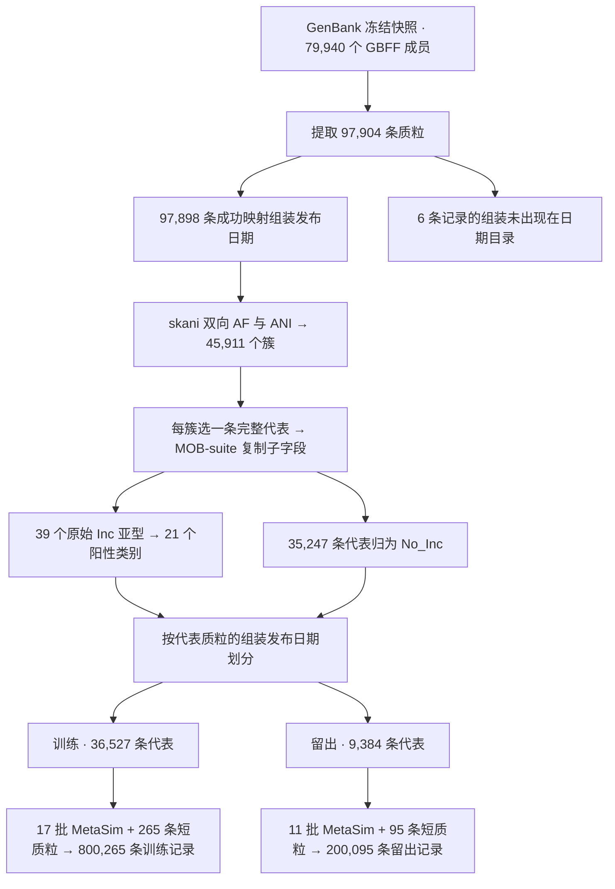

# IncFinder rc2 的 21 个 Inc 类别是怎样形成的

[English](README.md) · [软件首页](../README.zh-CN.md) · [独立数据 Release](https://github.com/chrisjack007/IncFinder_showcase/releases/tag/v0.5.0rc2-provenance.1) · [字段字典](FIELDS.zh-CN.md)

IncFinder 的 21 个阳性类别来自完整代表质粒的复制子分型。研究先对 GenBank 质粒去冗余，再用 MOB-suite 对完整代表分型，在全部代表上统计并归并亚型。之后才按日期划分训练与留出质粒，用 MetaSim 抽样。片段标签描述它来自哪类质粒。单个片段是否覆盖复制子位点，需要另行核实。[rc2 模型合同](../NT_V3_650M_TSRF_SW/config/contract.json)



## 从 GenBank 到完整代表

原始记录以版本化组装 accession 和版本化序列 accession 为复合键。历史提取规则采用 GenBank 的 source 特征带有 plasmid 限定符，或描述中含 plasmid 且不含 chromosome 的记录。冻结日期目录含 143,513 条不同组装记录。按组装 accession 连接后，下列 6 条记录缺少对应的组装行，仍可在 accessions.tsv.gz 查到。

每行对应一个在冻结日期目录中缺少发布日期的组装。左列是版本化组装号，右列逐项列出该组装下未进入去冗余的版本化质粒序列号。数右列的序列号可得到 6 条记录，它们来自左列的 2 个组装。

| 组装 | 未进入去冗余的序列 |
|---|---|
| GCA_006228425.1 | CP030165.1 |
| GCA_029536795.1 | CP120578.1、CP120579.1、CP120580.1、CP120582.1、CP120583.1 |

skani 搜索清单只含长度至少 500 bp 的输入。聚类先为全部 97,898 条记录各建一个节点。不同记录间 ANI ≥ 80%，且参考端和查询端 AF 中较小者 ≥ 90% 时连边，再取连通分量。历史摘要中的 3,544,354 是过滤后的非自比搜索行数，计数保留搜索方向。得到 45,911 个簇后，每簇先选组装发布日期最早者，同日选序列较长者，仍相同则按历史 FASTA 路径字典序取首条。查询复算结果时可比较成员集合和代表 accession，簇编号仅用于本次视图。[skani 0.3.1](https://github.com/bluenote-1577/skani/releases/tag/v0.3.1)

<a id="class-counts"></a>

## 从复制子字段到 21 类

MOB-suite 3.1.9 对完整代表质粒分型。从复制子字段提取 Inc 亚型后，同一质粒上重复出现的同一亚型只计一次。类别依据 2026-05-07 的规则在全部代表上确定。 [2026-05-07 原始决策](POLICY-SOURCES.md) · [39 行亚型归并表](subtype-policy.tsv) · [字段含义](FIELDS.zh-CN.md#subtype-policy) · [MOB-suite 参考库](https://doi.org/10.5281/zenodo.10304948)

**纵向读类别。** 每行是一个最终参考类别。前 21 行按 rc2 的第二层输出顺序排列。末行 `No_Inc` 表示未从完整代表质粒提取到 Inc 亚型，是第一层的阴性参考类别，二层列号和原始 Inc 亚型均记为 `—`。

**横向读七列。**

- **二层列号**是该类在 21 维概率向量中从 0 到 20 的索引。**最终类别**是归并后的研究标签。**原始 Inc 亚型**列出从 MOB-suite 复制子字段提取并归入该行的成员。
- **归并理由**给出适用的数量门槛或分支规则。100 条门槛以不同代表质粒为计数单位。**代表质粒数**是在全部 45,911 条完整代表中具有该最终标签的不同质粒数，同一质粒在该行只计一次。
- **训练记录数**是在 800,265 条训练记录中继承该标签的记录数。**留出记录数**是在 200,095 条留出记录中继承该标签的记录数。两列分别包括训练端补入的 265 条和留出端补入的 95 条完整短质粒中具有该标签的记录。

| 二层列号 | 最终类别 | 原始 Inc 亚型 | 归并理由 | 代表质粒数 | 训练记录数 | 留出记录数 |
|---:|---|---|---|---:|---:|---:|
| 0 | Inc18 | Inc18 | 大类覆盖至少 100 条，只有一个原始亚型 | 115 | 1,493 | 326 |
| 1 | IncC | IncC | 大类覆盖至少 100 条，只有一个原始亚型 | 348 | 7,773 | 1,839 |
| 2 | IncFIA | IncFIA | 多亚型大类中，该亚型覆盖至少 100 条 | 2,816 | 37,464 | 10,565 |
| 3 | IncFIB | IncFIB | 多亚型大类中，该亚型覆盖至少 100 条 | 4,144 | 80,158 | 17,969 |
| 4 | IncFIC | IncFIC | 多亚型大类中，该亚型覆盖至少 100 条 | 1,361 | 19,530 | 5,290 |
| 5 | IncFII | IncFII | 多亚型大类中，该亚型覆盖至少 100 条 | 3,122 | 51,585 | 12,765 |
| 6 | IncHI1 | IncHI1A, IncHI1B | 两个同分支亚型并入 IncHI1 | 715 | 18,416 | 4,035 |
| 7 | IncHI2 | IncHI2A | 分支亚型并入父类 | 310 | 10,987 | 2,224 |
| 8 | IncI | IncI-gamma/K1, IncI1, IncI1/B/O, IncI2 | 初次归并后仍有小类不足 100，合并整个 IncI 大类 | 567 | 7,122 | 1,509 |
| 9 | IncK | IncK2/Z | 大类覆盖至少 100 条，只有一个原始亚型 | 171 | 2,248 | 620 |
| 10 | IncL | IncL/M | 大类覆盖至少 100 条，只有一个原始亚型 | 114 | 1,335 | 217 |
| 11 | IncN | IncN, IncN2 | 保留 IncN，将小亚型 IncN2 并入大类 | 464 | 5,813 | 1,161 |
| 12 | IncP | IncP | 大类覆盖至少 100 条，只有一个原始亚型 | 295 | 5,200 | 1,152 |
| 13 | IncQ | IncQ1, IncQ2 | 初次归并后仍有小类不足 100，合并整个 IncQ 大类 | 290 | 5,698 | 813 |
| 14 | IncR | IncR | 大类覆盖至少 100 条，只有一个原始亚型 | 1,000 | 11,932 | 3,322 |
| 15 | IncU | IncU | 大类覆盖至少 100 条，只有一个原始亚型 | 436 | 8,121 | 2,604 |
| 16 | IncX1 | IncX1 | 多亚型大类中，该亚型覆盖至少 100 条 | 458 | 4,585 | 906 |
| 17 | IncX3 | IncX3 | 多亚型大类中，该亚型覆盖至少 100 条 | 151 | 1,510 | 590 |
| 18 | IncX_other | IncX2, IncX4, IncX5, IncX6, IncX7, IncX8, IncX9 | 频数较低的 IncX 亚型合并后仍覆盖至少 100 条 | 116 | 770 | 164 |
| 19 | IncY | IncY | 大类覆盖至少 100 条，只有一个原始亚型 | 225 | 3,048 | 563 |
| 20 | Inc_other | Inc10, Inc11, Inc13, Inc4, IncA, IncT, IncW | 原大类分别少于 100 条 | 202 | 3,197 | 875 |
| — | No_Inc | — | 未提取到 Inc 亚型 | 35,247 | 631,608 | 161,382 |

**以 `IncHI1` 一行为例。** 列号 6 对应概率向量的第 7 个值。`IncHI1A` 出现在 44 条代表上，`IncHI1B` 出现在 672 条代表上，其中 1 条同时具有两个亚型。初步支持数为 716，去重后有 **715 条代表质粒**。继承 `IncHI1` 的记录分别有 **18,416 条训练记录**和 **4,035 条留出记录**。片段是否覆盖复制子位点，需要另行核实。

10,664 条代表至少有一个阳性标签，其中 5,046 条具有多个最终标签。同一质粒或记录可计入多行，跨类别求和会重复计数。历史规则先对各亚型和大类按质粒去重，再在大类内相加归入同一初步标签的亚型计数。若初步标签仍少于 100，符合规则的字母大类整体归并。最终覆盖数再按质粒去重。软件的 `ct` 和 `u05` 阈值用于预测。

## 从代表到训练或留出记录

组装发布日期在 2024 年及以前的质粒进入训练集，2025 年起进入留出集。训练折号按质粒分配。MetaSim 0.9.5 在训练端生成 800,000 条记录，留出端生成 200,000 条，再分别补入 265 和 95 条不足 1,000 bp 的完整质粒。最终训练与留出记录的实测长度分别为 200–10,000 和 212–10,000 bp。实际贡献记录的来源质粒分别为 35,893 和 9,236 条，两个集合没有交叉。模型卡还记录了一条留出序列与四条训练序列完全相同。[模型卡](../docs/MODEL_CARD.zh-CN.md) · [rc2 训练输入与输出摘要](../NT_V3_650M_TSRF_SW/config/research_index.json)

训练集的十折分配沿用历史工作簿中每条代表质粒的折号。导出冻结表时，已逐行核对 rc2 的训练折号数组和两个划分的标签矩阵。复算时，同一代表 accession 继承该固定折号，留出记录的折号为空。

## 三条可以直接反查的记录

每行选取一条留出片段。第一列标明示例情形，第二列给出可用于 `trace --record` 的记录 ID 和片段长度（bp），第三列沿来源质粒的复制子字段读到片段继承的参考标签，末列链接该来源质粒的版本化 GenBank 记录。

| 例子 | 片段（长度） | 从原始字段到最终标签 | 来源质粒（GenBank） |
|---|---|---|---|
| 多标签 | test_frag_000045001，2,800 bp | 原始复制子字段含两次 IncFIB 和一次 IncFII。去重后继承 IncFIB 与 IncFII。 | [OZ180215.1](https://www.ncbi.nlm.nih.gov/nuccore/OZ180215.1) |
| 同分支归并 | test_frag_000129761，1,025 bp | IncHI1A 和 IncHI1B 同时出现，归并后只保留 IncHI1。 | [JBREQR010000002.1](https://www.ncbi.nlm.nih.gov/nuccore/JBREQR010000002.1) |
| No_Inc | test_frag_000000001，889 bp | 复制子字段为短横线。片段跨来源质粒的环起点，继承 No_Inc。 | [JBKHUK010000010.1](https://www.ncbi.nlm.nih.gov/nuccore/JBKHUK010000010.1) |

在数据 Release 下载并解压冻结包和查询程序。以下命令在解压目录的上一级运行，使用 Python 3.10 或更新版本。Windows 安装 Python 时也可用 py -3 调用。每个查询会给出可在 NCBI 打开的版本化序列和组装链接。

```bash
python incfinder_provenance.py verify
python incfinder_provenance.py trace --record test_frag_000045001
python incfinder_provenance.py trace --record test_frag_000129761
python incfinder_provenance.py trace --record test_frag_000000001
python incfinder_provenance.py trace --label IncHI1
```

默认读取 frozen 目录。追加 --data replay 即可查询复算视图。发行附件、签名校验、上游数据获取、分阶段执行方法和逐阶段差异见[复算说明](REPLAY.zh-CN.md)。
